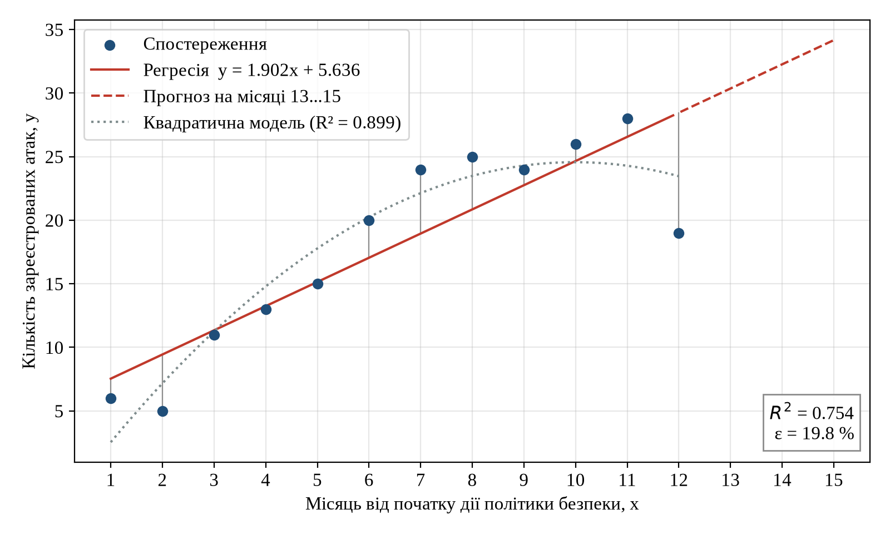
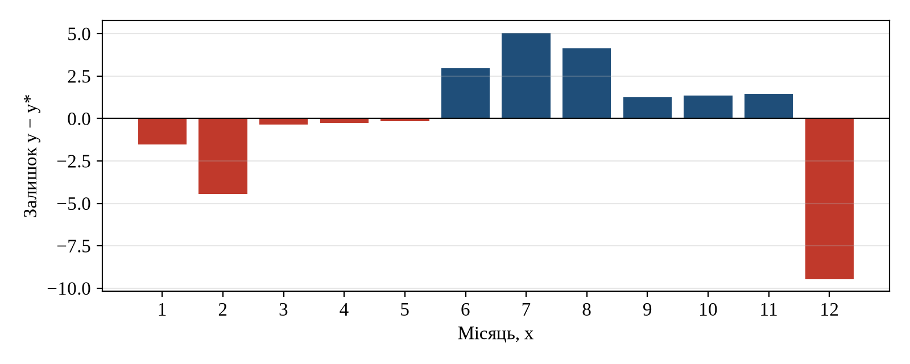

# Мета роботи

Опанувати підходи до оцінювання дієвості політики безпеки об'єкта критичної
інфраструктури (ОКІ) та реалізувати на практиці аналіз поведінки ризиків за
допомогою моделі лінійної регресії: побудувати модель, перевірити її
адекватність і точність, зробити висновки про динаміку ризику, дієвість
політики та заходи, які слід посилити.

# Постановка задачі

Відповідно до варіанта 3 задано результати спостереження за ОКІ впродовж
12 місяців від початку дії політики безпеки, дієвість якої оцінюється
(табл. 2.1). Тут $x$ означає номер місяця, $y$ означає кількість
**зареєстрованих атак** у цьому місяці (наприклад, за журналами системи
захисту).

\needspace{3.2cm}

: Таблиця 2.1. Вихідні дані (варіант 3)

| $x$ | 1 | 2 | 3 | 4 | 5 | 6 | 7 | 8 | 9 | 10 | 11 | 12 |
|:---:|:-:|:-:|:-:|:-:|:-:|:-:|:-:|:-:|:-:|:--:|:--:|:--:|
| $y$ | 6 | 5 | 11 | 13 | 15 | 20 | 24 | 25 | 24 | 26 | 28 | 19 |

Необхідно:

1. побудувати лінійну регресію $y = ax + b + \varepsilon$ (графік) і обчислити
   параметри за формулами (1)...(6) методички;
2. обчислити коефіцієнт детермінації та похибку апроксимації (7), (8), зробити
   висновки про адекватність і точність моделі;
3. зробити висновки про динаміку ризику (зростаюча чи спадна) і про що вона
   свідчить;
4. зробити висновки про дієвість політики безпеки та фактори, що впливають на
   ефективність заходів захисту;
5. дати рекомендації, які заходи слід посилити.

# Теоретичні відомості

Регресією називають зміну результуючої змінної залежно від зміни незалежних
факторів. Для прогнозу частоти загроз використовують модель

$$ y = ax + b + \varepsilon, \tag{3.1} $$

де $a$, $b$ є параметрами регресії, $\varepsilon$ є похибкою. Параметри
оцінюються методом найменших квадратів (МНК):

$$ a_{\text{МНК}} = \frac{\operatorname{cov}_{x,y}}{\sigma_x^2}, \qquad
   b = \bar y - a_{\text{МНК}}\,\bar x, \tag{3.2} $$

$$ \bar x = \frac{1}{n}\sum_{i=1}^{n} x_i, \qquad
   \bar y = \frac{1}{n}\sum_{i=1}^{n} y_i, \tag{3.3} $$

$$ \sigma_x^2 = \frac{\sum_{i=1}^{n}(x_i-\bar x)^2}{n-1}, \qquad
   \operatorname{cov}_{x,y} = \frac{\sum_{i=1}^{n}(x_i-\bar x)(y_i-\bar y)}{n-1}. \tag{3.4} $$

Адекватність лінійної моделі перевіряється коефіцієнтом детермінації, а
точність перевіряється середньою відносною похибкою апроксимації:

$$ R^2 = \frac{\sum_{i=1}^{n}(y_i^{*}-\bar y)^2}{\sum_{i=1}^{n}(y_i-\bar y)^2},
   \qquad
   \varepsilon = \frac{1}{n}\sum_{i=1}^{n}\left|\frac{y_i-y_i^{*}}{y_i}\right|\cdot 100\,\%,
   \qquad y_i^{*} = a x_i + b. \tag{3.5} $$

Значення $R^2$, близьке до одиниці, свідчить про наявність лінійного зв'язку
між $x$ і $y$. Для похибки апроксимації використано поширену шкалу Льюїса [5]:
$\varepsilon < 10\,\%$ означає високу точність, $10...20\,\%$ добру,
$20...50\,\%$ задовільну, понад $50\,\%$ незадовільну.

# Хід виконання

Розрахунки виконано скриптом `solution.py` (Python, NumPy). Формули
(3.2)...(3.5) запрограмовано безпосередньо, без бібліотечних функцій регресії;
результат звірено з `numpy.polyfit`, розбіжностей немає. Проміжні величини
наведено в табл. 4.1, де позначено $\Delta x_i = x_i-\bar x$,
$\Delta y_i = y_i-\bar y$, $\Delta y_i^{*} = y_i^{*}-\bar y$, $\delta_i = \lvert y_i-y_i^{*}\rvert / y_i$.

\needspace{9cm}

\begingroup\small

: Таблиця 4.1. Проміжні обчислення

| $x_i$ | $y_i$ | $\Delta x_i$ | $\Delta y_i$ | $\Delta x_i^2$ | $\Delta x_i \Delta y_i$ | $y_i^{*}$ | $(\Delta y_i^{*})^2$ | $\Delta y_i^2$ | $\delta_i$ |
|--:|--:|--:|--:|--:|--:|--:|--:|--:|--:|
| 1 | 6 | −5,5 | −12 | 30,25 | 66,0 | 7,54 | 109,44 | 144 | 0,256 |
| 2 | 5 | −4,5 | −13 | 20,25 | 58,5 | 9,44 | 73,26 | 169 | 0,888 |
| 3 | 11 | −3,5 | −7 | 12,25 | 24,5 | 11,34 | 44,32 | 49 | 0,031 |
| 4 | 13 | −2,5 | −5 | 6,25 | 12,5 | 13,24 | 22,61 | 25 | 0,019 |
| 5 | 15 | −1,5 | −3 | 2,25 | 4,5 | 15,15 | 8,14 | 9 | 0,010 |
| 6 | 20 | −0,5 | 2 | 0,25 | −1,0 | 17,05 | 0,90 | 4 | 0,148 |
| 7 | 24 | 0,5 | 6 | 0,25 | 3,0 | 18,95 | 0,90 | 36 | 0,210 |
| 8 | 25 | 1,5 | 7 | 2,25 | 10,5 | 20,85 | 8,14 | 49 | 0,166 |
| 9 | 24 | 2,5 | 6 | 6,25 | 15,0 | 22,76 | 22,61 | 36 | 0,052 |
| 10 | 26 | 3,5 | 8 | 12,25 | 28,0 | 24,66 | 44,32 | 64 | 0,052 |
| 11 | 28 | 4,5 | 10 | 20,25 | 45,0 | 26,56 | 73,26 | 100 | 0,051 |
| 12 | 19 | 5,5 | 1 | 30,25 | 5,5 | 28,46 | 109,44 | 1 | 0,498 |
| **Σ 78** | **216** | 0 | 0 | **143** | **272** | 216 | **517,37** | **686** | **2,381** |

\endgroup

## Середні значення, дисперсія, коваріація

$$ \bar x = \frac{78}{12} = 6{,}5, \qquad \bar y = \frac{216}{12} = 18{,}0, $$

$$ \sigma_x^2 = \frac{143}{11} = 13{,}0, \qquad
   \operatorname{cov}_{x,y} = \frac{272}{11} \approx 24{,}727. $$

## Параметри регресії

$$ a_{\text{МНК}} = \frac{24{,}727}{13{,}0} \approx 1{,}902, \qquad
   b = 18{,}0 - 1{,}902\cdot 6{,}5 \approx 5{,}636. $$

Отже, модель має вигляд

$$ y^{*} = 1{,}902\,x + 5{,}636. \tag{4.1} $$

Щомісяця кількість зареєстрованих атак у середньому зростає майже на
**дві** атаки.

## Адекватність і точність моделі

$$ R^2 = \frac{517{,}37}{686} \approx 0{,}754, \qquad
   \varepsilon = \frac{2{,}381}{12}\cdot 100\,\% \approx 19{,}8\,\%. $$

Результат моделювання показано на рис. 4.1, залишки на рис. 4.2.

{ width=95% }

{ width=90% }

## Додаткові перевірки

Щоб висновки не спиралися лише на $R^2$, виконано три додаткові перевірки.

**Значущість нахилу.** Стандартна похибка регресії
$s_e = \sqrt{\sum (y_i-y_i^{*})^2/(n-2)} \approx 4{,}11$, стандартна похибка
нахилу $s_a = s_e/\sqrt{\sum (x_i-\bar x)^2} \approx 0{,}343$, статистика
$t = a/s_a \approx 5{,}54$. Це більше за критичне значення
$t_{0{,}975;\,10} = 2{,}228$, тому зростання є статистично значущим, а не
випадковим коливанням. Коефіцієнт кореляції Пірсона $r \approx 0{,}868$.

**Нахил окремо за півріччями.** У першому півріччі (місяці 1...6) нахил становить
$+2{,}91$ атаки на місяць, у другому (місяці 7...12) він становить $-0{,}40$.
Сумарно за півріччями зареєстровано 70 і 146 атак відповідно. Тобто зростання
відбувалося переважно на початку періоду, далі настало насичення на рівні
24...28 атак, а в 12-му місяці кількість впала до 19.

**Порівняльна нелінійна модель.** Квадратична модель
$y^{*} = -0{,}273x^2 + 5{,}448x - 2{,}636$ дає $R^2 \approx 0{,}899$ і
$\varepsilon \approx 16{,}2\,\%$, її максимум припадає на $x \approx 10$. Вона
описує дані помітно краще за лінійну, що підтверджує картину «зростання, потім
насичення».

\needspace{6.5cm}

: Таблиця 4.2. Зведені результати

| Показник | Значення |
|---|---:|
| Параметри лінійної регресії $a$, $b$ | 1,902; 5,636 |
| Коефіцієнт детермінації $R^2$ | 0,754 |
| Похибка апроксимації $\varepsilon$ | 19,8 % |
| Похибка без місяців 1, 2 (малі $y$) | 12,4 % |
| $t$-статистика нахилу (критичне 2,228) | 5,54 |
| $R^2$ / $\varepsilon$ квадратичної моделі | 0,899 / 16,2 % |
| Прогноз за (4.1) на місяці 13, 14, 15 | 30,4; 32,3; 34,2 |

# Аналіз результатів

## Адекватність і точність моделювання

$R^2 = 0{,}754$: лінійна модель пояснює близько 75 % мінливості кількості
атак, кореляційний зв'язок високий ($r = 0{,}87$). Модель можна вважати
**адекватною** для визначення напрямку тренду, і цей тренд статистично
значущий.

Точність моделі **на верхній межі доброї**: $\varepsilon = 19{,}8\,\%$ лежить
скраю діапазону «добра точність» (10...20 %), майже на межі із «задовільною». Основний внесок дають три точки: місяць 2
(відносна похибка 89 % через мале $y = 5$), місяць 12 (50 %, різкий спад) і
місяць 1 (26 %). Без перших двох місяців похибка становить 12,4 %. Систематичний
характер залишків (рис. 4.2: на початку та в кінці від'ємні, посередині
додатні) показує, що справжня залежність нелінійна, тому прогноз за (4.1) на
місяці 13...15 (30...34 атаки) слід вважати завищеним.

## Динаміка ризику

Динаміка ризику **зростаюча**: за рік кількість зареєстрованих атак зросла
з 5...6 до 24...28 на місяць, тобто приблизно в 4...5 разів. Водночас у
другому півріччі зростання зупинилося, а останнє спостереження показує спад.

Показник варіанта означає саме *зареєстровані*, а не *успішні*
атаки. Тому зростання можна тлумачити двояко:

1. **Реальне зростання загрози.** Об'єкт став привабливішою ціллю, з'явилися
   нові вектори атак (наприклад, хвилі DDoS, фішингові кампанії, автоматизоване
   сканування), а політика безпеки не стримує нападників. Для зовнішніх атак
   це очікувано: політика безпеки самого об'єкта майже не впливає на те, скільки
   разів його атакують.
2. **Зростання видимості.** Нова політика могла запровадити централізований
   збір журналів, IDS/SIEM та обов'язкову реєстрацію інцидентів. Тоді на
   початку періоду атаки просто не реєструвалися, а крива відображає
   дозрівання процесу моніторингу. Насичення в місяцях 7...11 добре узгоджується
   з цим поясненням: система виявлення вийшла на повну потужність.

Спад у 12-му місяці може означати як реальне зменшення активності (у тому числі
внаслідок дії політики), так і проблему з реєстрацією (збій сенсора, відпустки
персоналу, зміна правил кореляції). Одне спостереження не дає підстав для
висновку, його треба перевірити за наступні місяці.

## Дієвість політики безпеки

За першим критерієм методички (динаміка найсуттєвіших ризиків) політику
безпеки **не можна визнати дієвою** щодо зменшення частоти атак: значущого
спаду немає, рівень наприкінці періоду в 3...4 рази вищий за початковий.
Водночас вибраний показник не дозволяє однозначно оцінити ризик, оскільки
ризик визначається як поєднання ймовірності реалізації загрози та
її наслідків. Кількість зареєстрованих атак характеризує інтенсивність
загроз та якість їх виявлення, але нічого не говорить про шкоду. Щоб
зробити остаточний висновок, необхідно співставити ці дані з кількістю
**успішних** атак і збитками (критерій 2 методички), результатами
тестування на проникнення (критерій 4) та виконанням чеклістів (критерій 3).

Фактори, що впливають на ефективність заходів захисту:

* повнота та стабільність реєстрації подій (покриття сенсорами, налаштування
  кореляції, кількість хибних спрацювань);
* зміна зовнішнього ландшафту загроз, на яку політика об'єкта не впливає;
* швидкість впровадження технічних заходів (сегментація, патчі, фільтрація) і
  їх відповідність реальним векторам атак;
* підготовка персоналу та виконання організаційних заходів;
* фінансування заходів захисту та їх розподіл у часі;
* для ОКІ: залежність від постачальників і підрядників із віддаленим доступом,
  наявність застарілих протоколів (Modbus, DNP3) без автентифікації.

## Рекомендації

1. **Розділити показник.** Окремо вести облік зареєстрованих, відбитих і
   успішних атак за типами (DDoS, шкідливе ПЗ, сканування, спроби НСД).
   Дієвість політики оцінювати за часткою успішних атак та часом реагування
   (MTTD, MTTR), а не лише за загальною кількістю.
2. **Перевірити якість моніторингу.** Провести аудит джерел журналів SIEM,
   з'ясувати причину спаду в 12-му місяці, налаштувати контроль «мовчання»
   сенсорів.
3. **Посилити периметр і сегментацію.** Розділити корпоративну (IT) та
   технологічну (OT) мережі, обмежити віддалений доступ до SCADA/PLC через
   jump-сервери з MFA, застосувати фільтрацію та захист від DDoS на рівні
   провайдера.
4. **Зменшити поверхню атаки.** Інвентаризувати активи, закрити зайві сервіси,
   змінити паролі за замовчуванням, регулярно встановлювати оновлення
   відповідно до бюлетенів CERT-UA та ICS-CERT.
5. **Підготувати персонал.** Проводити навчання з фішингу та соціальної
   інженерії, відпрацьовувати план реагування на інциденти.
6. **Регулярно перевіряти політику.** Проводити тестування на проникнення та
   повторювати регресійний аналіз щокварталу, бажано з нелінійними моделями
   та довшим рядом спостережень.

# Відповіді на контрольні питання

**1. Які види атак та яким чином можна зареєструвати?** Мережеві атаки
(сканування, DDoS, експлуатація вразливостей сервісів) реєструються
системами виявлення вторгнень (IDS/IPS), міжмережевими екранами та
аналізом NetFlow. Атаки шкідливого ПЗ реєструються антивірусами та
EDR. Спроби НСД, підбір паролів і зловживання привілеями виявляються
за журналами автентифікації ОС, AD і VPN. Фішинг реєструється поштовими
шлюзами та скаргами користувачів. Атаки на ICS виявляються спеціалізованими
сенсорами OT-трафіку (аналіз команд Modbus/DNP3, зміни логіки PLC). Події
з усіх джерел збираються та корелюються в SIEM, а інциденти фіксуються в
журналі реагування.

**2. Які види атак є найбільш типовими для ОКІ?** Цільові APT-атаки
(Industroyer, BlackEnergy, Stuxnet), DDoS на веб-сервіси та канали зв'язку,
програми-вимагачі та вайпери, фішинг як початковий вектор, атаки через
постачальників і віддалений доступ підрядників, експлуатація незахищених
промислових протоколів, а також інсайдерські дії.

**3. Як перевіряється адекватність і точність моделювання?** Адекватність
перевіряється коефіцієнтом детермінації $R^2$: чим ближче він до одиниці,
тим краще лінійна залежність пояснює дані. Додатково перевіряють
значущість коефіцієнтів (t-критерій) і характер залишків. Точність
перевіряється середньою відносною похибкою апроксимації $\varepsilon$.

**4. Коли не можна робити висновки про дієвість політики за регресійною
моделлю, навіть якщо $R^2 \approx 1$?** Коли показник $y$ відображає не
ризик, а щось інше: наприклад, кількість *зареєстрованих* атак залежить від
якості моніторингу. Також, коли за період змінилися умови (нові сенсори,
методика обліку, зовнішня кампанія атак), коли ряд занадто короткий або має
сезонність, коли кореляція з часом не означає причинного зв'язку з політикою,
коли не враховано наслідки (збитки), або коли модель використовується для
екстраполяції далеко за межі періоду спостереження.

**5. Які фактори впливають на дієвість політики безпеки?** Відповідність
політики реальній моделі загроз, повнота та своєчасність впровадження
технічних і організаційних заходів, підтримка керівництва та фінансування,
кваліфікація й дисципліна персоналу, якість моніторингу та реагування, а
також зовнішній ландшафт загроз і вимоги законодавства (Закон України
«Про критичну інфраструктуру»).

**6. Які додаткові критерії можна розглянути?** Частку успішних атак, час
виявлення та реагування (MTTD, MTTR), величину фінансових і репутаційних
збитків, кореляцію витрат на безпеку з динамікою ризиків, результати
тестування на проникнення та аудиту відповідності (ISO/IEC 27001,
IEC 62443), рівень виконання чеклістів, кількість відкритих вразливостей
та середній час їх усунення, а також результати навчань персоналу.

# Висновки

Побудовано лінійну регресійну модель $y^{*} = 1{,}902x + 5{,}636$ для
кількості зареєстрованих атак на ОКІ впродовж 12 місяців дії політики безпеки.
Модель адекватна ($R^2 = 0{,}754$, нахил значущий, $t = 5{,}54$), а її точність
на верхній межі доброї ($\varepsilon = 19{,}8\,\%$), бо реальна залежність
нелінійна: швидке зростання в першому півріччі змінилося насиченням і спадом
наприкінці року (квадратична модель дає $R^2 = 0{,}899$). Динаміка ризику
зростаюча, тому за цим критерієм політику не можна вважати дієвою, із
застереженням (докладно розглянутим вище), що показник відображає
*зареєстровані*, а не успішні атаки. Основні рекомендації: розділити облік
атак за результатом і типом, перевірити якість моніторингу, посилити
сегментацію IT/OT, захист віддаленого доступу та захист від DDoS.

# Перелік джерел

1. Стьопочкіна І. В., Ільїн К. І., Овчарук М. В. Кіберзахист об'єктів
   критичної інфраструктури. Лабораторний практикум : навч. посіб. Київ :
   КПІ ім. Ігоря Сікорського, 2023. 59 с.
2. Про критичну інфраструктуру : Закон України від 16.11.2021 № 1882-IX.
   URL: https://zakon.rada.gov.ua/laws/show/1882-20
3. ISO/IEC 27004:2016. Information technology. Security techniques.
   Information security management. Monitoring, measurement, analysis and
   evaluation. Geneva : ISO, 2016.
4. Chew E., Swanson M., Stine K. et al. Performance Measurement Guide for
   Information Security : NIST SP 800-55 Rev. 1. Gaithersburg : NIST, 2008.
5. Lewis C. D. Industrial and Business Forecasting Methods. London :
   Butterworths, 1982. 144 p.
6. Montgomery D. C., Peck E. A., Vining G. G. Introduction to Linear
   Regression Analysis. 6th ed. Hoboken : Wiley, 2021. 704 p.
