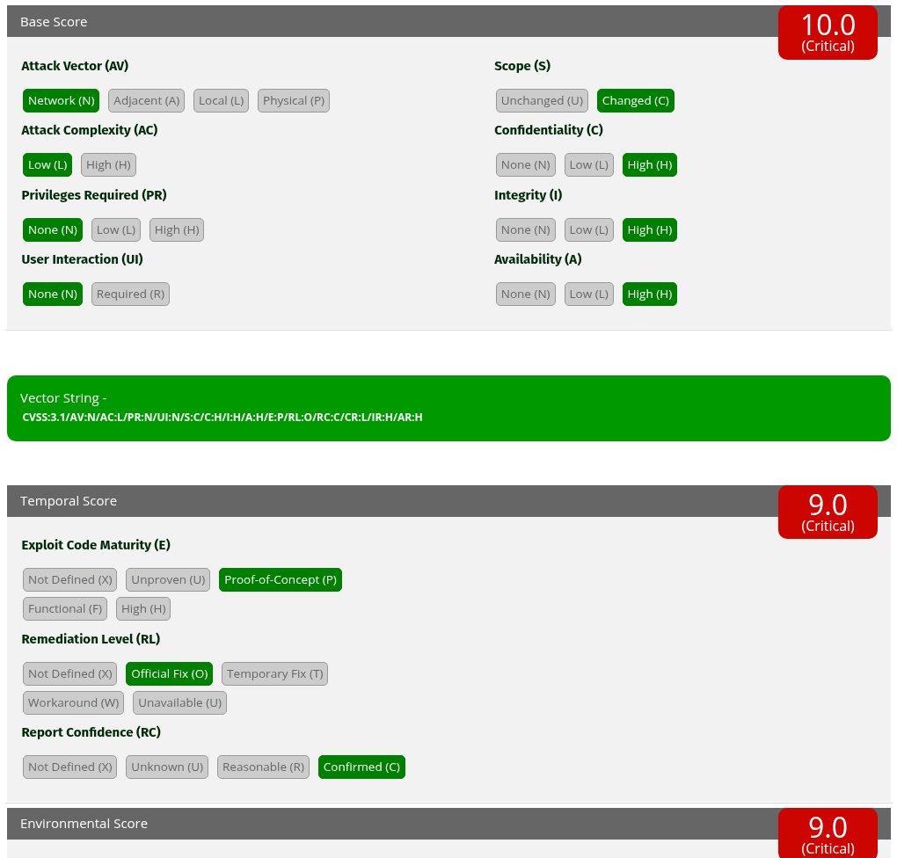
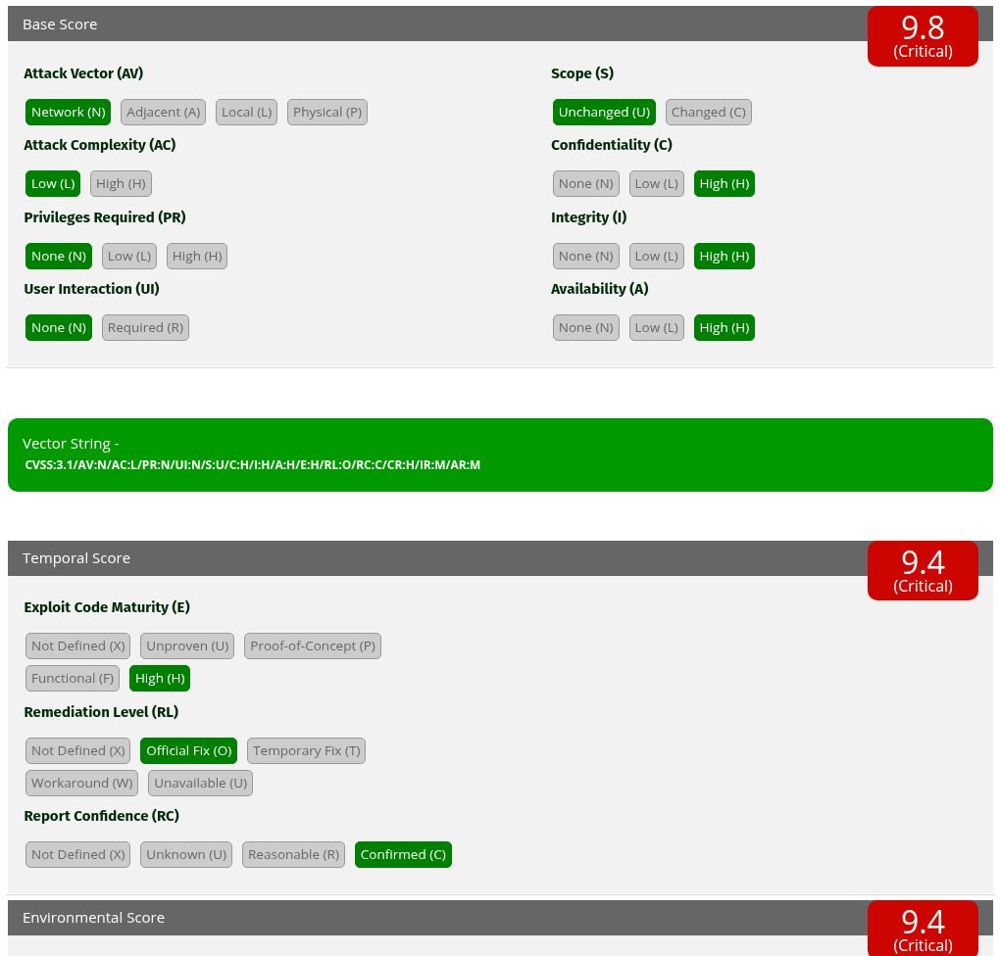
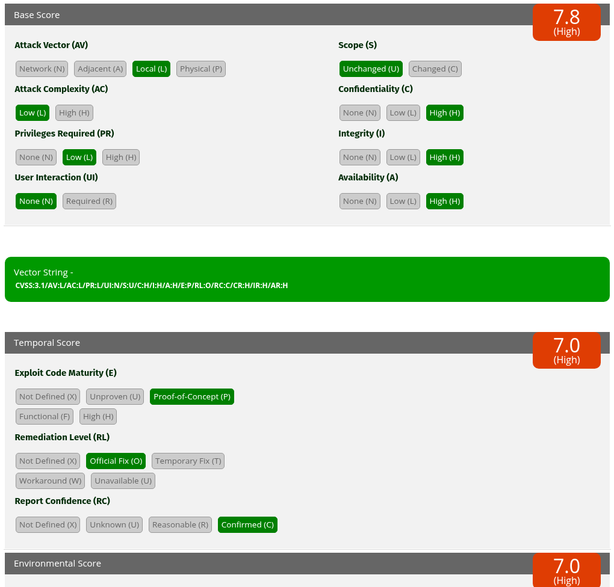
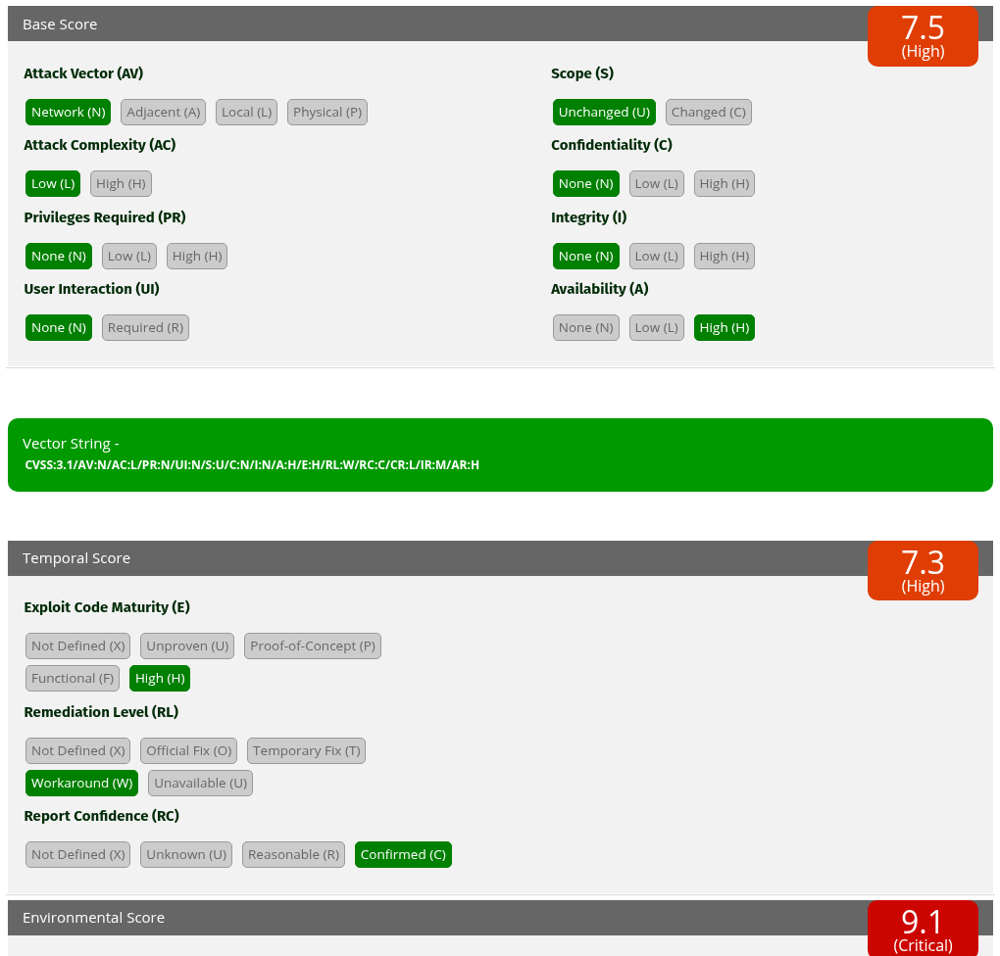
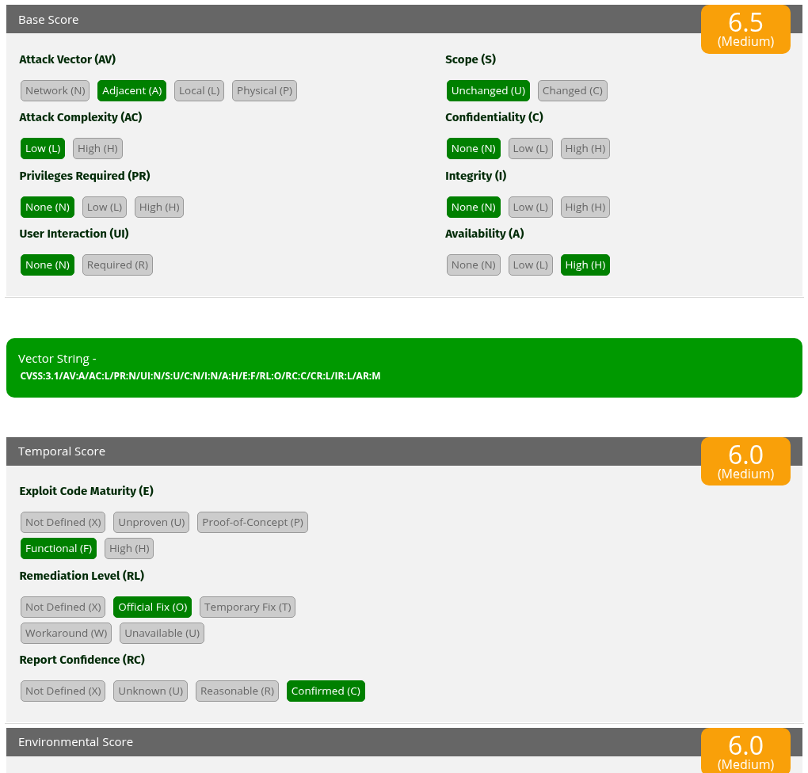
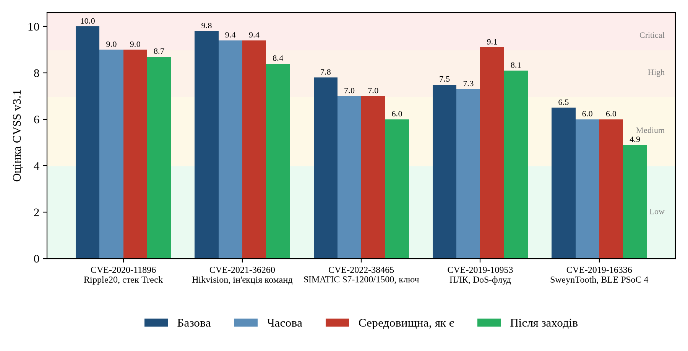

# Мета роботи

Ознайомитися з моделлю загроз, типовою для об'єктів критичної інфраструктури
(ОКІ), на прикладі промислового інтернету речей (ІІоТ). Опанувати методику
розрахунку показника CVSS за Common Vulnerability Scoring System v3.1 на
прикладі вразливостей кінцевих пристроїв ОКІ.

# Постановка задачі

Номер у списку 3, отже варіант $3 \bmod 10 + 1 = 4$: **експлуатація
вразливостей програмного забезпечення (або прошивки) кінцевих пристроїв ІІоТ**.

Завдання:

1. зібрати дані про типові атаки цього класу на ОКІ, проаналізувати можливі
   шляхи їх здійснення, коротко описати атаки та заповнити таблицю метрик для
   конкретних випадків;
2. за допомогою калькулятора фреймворку обчислити значення CVSS;
3. зробити висновки про рівень небезпечності для заданого об'єкта;
4. надати рекомендації щодо усунення проблем на ОКІ.

Для конкретики розглянуто п'ять реальних вразливостей із бази NVD, що
охоплюють різні типи кінцевих пристроїв ІІоТ і всі практично важливі вектори
атаки: мережевий (N), суміжний (A) і локальний (L).

# Теоретичні відомості

## Метрики CVSS v3.1

CVSS оцінює **серйозність** вразливості числом від 0 до 10. Метрики поділено
на три групи:

* **базові** (Base) описують властивості самої вразливості, незмінні в часі
  та однакові для всіх середовищ: вектор (AV), складність (AC), потрібні
  привілеї (PR), взаємодія з користувачем (UI), область впливу (S) і вплив на
  конфіденційність, цілісність, доступність (C, I, A);
* **часові** (Temporal) змінюються з часом: зрілість експлойта (E), рівень
  виправлення (RL), достовірність звіту (RC);
* **середовищні** (Environmental) налаштовують оцінку під конкретну
  організацію: вимоги до конфіденційності, цілісності, доступності активу
  (CR, IR, AR) та модифіковані базові метрики (MAV, MAC, ...), що враховують
  наявні засоби захисту.

Базова оцінка обчислюється так. Спочатку знаходиться базовий показник впливу

$$ ISS = 1 - (1-C)(1-I)(1-A), \tag{3.1} $$

де $C, I, A \in \{0{,}56;\ 0{,}22;\ 0\}$ для значень High, Low, None. Далі
обчислюються підоцінки впливу та експлуатованості:

$$ Impact = \begin{cases} 6{,}42 \cdot ISS, & S = U,\\
   7{,}52\,(ISS - 0{,}029) - 3{,}25\,(ISS - 0{,}02)^{15}, & S = C, \end{cases}
   \tag{3.2} $$

$$ Exploitability = 8{,}22 \cdot AV \cdot AC \cdot PR \cdot UI. \tag{3.3} $$

Базова оцінка дорівнює $\mathrm{Roundup}(\min(Impact + Exploitability,\ 10))$
для $S = U$ і $\mathrm{Roundup}(\min(1{,}08\,(Impact + Exploitability),\ 10))$
для $S = C$ (нуль, якщо $Impact \le 0$). Часова оцінка дорівнює
$\mathrm{Roundup}(Base \cdot E \cdot RL \cdot RC)$. Середовищна оцінка
обчислюється за тими самими формулами з модифікованими метриками, де вплив
зважується вимогами $CR, IR, AR \in \{1{,}5;\ 1;\ 0{,}5\}$ (High, Medium, Low).
$\mathrm{Roundup}$ означає округлення вгору до однієї десяткової цифри.

Якісна шкала: 0 None, 0,1...3,9 Low, 4,0...6,9 Medium, 7,0...8,9 High,
9,0...10,0 Critical.

## Об'єкт оцінювання

Як ОКІ взято умовний **міський водоканал** (сектор водопостачання за
Законом України «Про критичну інфраструктуру»). Архітектура відповідає моделі
Purdue: рівні 0...1 (датчики, виконавчі механізми, ПЛК насосних станцій),
рівень 2 (SCADA, HMI, інженерна станція), рівень 3 (Historian), DMZ і
корпоративна мережа. Для такого об'єкта головне значення мають **доступність**
і **цілісність** технологічного процесу: зупинка насосів або хибні команди
безпосередньо загрожують водопостачанню міста. Конфіденційність важлива
переважно для ключів, паролів і конфігурацій.

Вимоги до активів, використані в середовищних метриках, наведено в табл. 3.1.

\needspace{6cm}

: Таблиця 3.1. Активи водоканалу та вимоги до них

| Актив | CR | IR | AR |
|---|:-:|:-:|:-:|
| Мережеві карти ДБЖ, шлюзи RS-485/Ethernet | L | H | H |
| IP-камери охорони периметра | H | M | M |
| ПЛК керування насосами (Siemens S7-1200/1500) | H | H | H |
| ПЛК різних виробників (вразливість до флуду) | L | M | H |
| Бездротові BLE-датчики тиску й рівня | L | L | M |

# Хід виконання

## Методика

Для кожної вразливості:

1. базовий вектор узято з первинної оцінки NVD (файли `data/CVE-*.json`,
   отримані через NVD API 2.0);
2. часові метрики визначено за відкритими даними про експлойти та
   виправлення (обґрунтування в п. 4.2);
3. середовищну оцінку обчислено у двох станах: **«як є»** (лише вимоги
   CR, IR, AR з табл. 3.1) та **«після заходів»** (модифікована метрика, що
   відображає компенсуючий захід, поки виправлення ще не встановлено).

Оцінки обчислено двома незалежними способами: власним калькулятором
`cvss31.py`, написаним за специфікацією FIRST [1], і офіційним калькулятором
FIRST [2]. Скрипт `solution.py` порівнює результати автоматично; усі 20 оцінок
(4 оцінки для 5 вразливостей) збіглися, а базові також збіглися з NVD.

## Опис атак

### CVE-2020-11896: Ripple20, стек TCP/IP Treck {-}

Ripple20 означає групу з 19 вразливостей бібліотеки TCP/IP компанії Treck,
опубліковану дослідниками JSOF у червні 2020 року [3]. Бібліотеку
десятиліттями вбудовували у свої прошивки сотні виробників: ДБЖ (зокрема
мережеві карти APC), промислові шлюзи Digi, медичне обладнання, принтери,
компоненти систем керування. CVE-2020-11896 пов'язана з обробкою
фрагментованих пакетів IPv4-in-IPv4 (тунелювання): неправильна перевірка
довжини призводить до переповнення буфера (CWE-119) і до віддаленого
виконання коду **одним мережевим пакетом без автентифікації**. Область впливу
змінюється ($S = C$), бо скомпрометований мережевий стек дає контроль над
усім пристроєм і його функцією. Шлях атаки: доступ до сегмента, де є пристрій
(або до інтернету, якщо пристрій виставлено назовні), і надсилання
спеціального пакета. Головна проблема для ОКІ полягає в ланцюжку постачання:
власник часто не знає, що в його обладнанні є бібліотека Treck.

Часові метрики: E:P (JSOF опублікували технічний звіт з демонстрацією
експлуатації на реальному пристрої, але загальнодоступного бойового експлойта
немає), RL:O (Treck випустила версію 6.0.1.66, виробники пристроїв випускали
оновлення прошивок), RC:C.

### CVE-2021-36260: ін'єкція команд у вебсервері камер Hikvision {-}

Вбудований вебсервер багатьох IP-камер і відеореєстраторів Hikvision [9]
недостатньо перевіряє вхідні дані, тому спеціально сформований HTTP-запит
приводить до виконання команд ОС (CWE-78) **без автентифікації**.
Вразливість внесено до каталогу CISA KEV (активно експлуатується); її
за публічними повідомленнями [9], вразливість масово експлуатувалася ботнетами (зокрема Mirai-подібними).
На ОКІ камери охорони периметра часто підключено до тієї ж мережі, що й
інше обладнання, тому зламана камера стає плацдармом для руху всередину
мережі та розвідки, а також дозволяє «осліпити» фізичну охорону. Шлях атаки:
доступ до вебінтерфейсу камери (порт 80/443, часто проброшений назовні для
віддаленого перегляду).

Часові метрики: E:H (масова експлуатація, готові інструменти), RL:O
(оновлення прошивки від виробника), RC:C.

### CVE-2022-38465: ключ захисту ПЛК Siemens SIMATIC S7-1200/1500 {-}

Прошивки ПЛК SIMATIC S7-1200 і S7-1500 використовували **глобальний приватний
ключ**, однаковий для всієї лінійки продуктів, захищений недостатньо
(CWE-522). Згідно з бюлетенем Siemens [4], маючи доступ до
пам'яті одного контролера, можна витягти цей ключ [4]. Маючи його, зловмисник
розшифровує захищений обмін між інженерною станцією і **будь-яким** ПЛК цієї
лінійки, отримує паролі та конфігурацію, а також може підробляти комунікацію.
NVD оцінює вектор як локальний (AV:L, PR:L), а Siemens як виробник оцінює
вразливість суворіше: AV:L/PR:N/S:C, базова оцінка 9,3. Розбіжність показує,
що вибір області впливу ($S$) суттєво впливає на результат: один витягнутий
ключ ставить під загрозу всі інші контролери. Siemens усунула проблему оновленням прошивки (бюлетень SSA-568427 [4]).

Часові метрики: E:P (атаку продемонстровано дослідниками, вільного інструмента
немає), RL:O, RC:C.

### CVE-2019-10953: відмова в обслуговуванні ПЛК через мережевий флуд {-}

Згідно з бюлетенем CISA ICSA-19-106-03 [8], ПЛК кількох виробників (ABB, Phoenix Contact,
Schneider Electric, Siemens, WAGO) перестають нормально працювати під
потоком мережевих пакетів (CWE-400, CWE-770): ресурси процесора і мережевого
стеку вичерпуються, страждає обмін даними з SCADA і виконання циклу керування.
Атака тривіальна (стандартні засоби генерації трафіку), не потребує
автентифікації і порушує лише доступність. Для водоканалу саме доступність є
критичною вимогою, тому в середовищній оцінці ця вразливість стає однією з
найнебезпечніших.

Часові метрики: E:H (атака виконується загальнодоступними засобами), RL:W
(основні рекомендації виробників зводяться до обмеження трафіку і сегментації
мережі, тобто до обхідних заходів), RC:C.

### CVE-2019-16336: SweynTooth, BLE у мікроконтролерах Cypress PSoC 4 {-}

SweynTooth означає сімейство вразливостей реалізацій Bluetooth Low Energy
у SDK кількох виробників мікросхем, опубліковане дослідниками Singapore
University of Technology and Design у 2020 році [5]. CVE-2019-16336 у стеку
BLE Cypress PSoC 4 полягає в тому, що кадр канального рівня з довжиною
корисного навантаження, більшою за дозволену, приводить до збою (CWE-120)
і зупинки пристрою. Атакувальник має бути в радіусі дії радіоканалу (AV:A),
автентифікація не потрібна. На ОКІ такі мікросхеми використовуються в
бездротових датчиках і портативних пристроях налаштування; їх збій
означає втрату телеметрії.

Часові метрики: E:F (дослідники опублікували робочі PoC-скрипти для
доступного BLE-адаптера), RL:O (оновлення компонента BLE від Cypress), RC:C.

## Таблиця метрик

Значення метрик для всіх п'яти випадків наведено в табл. 4.1.

\needspace{16cm}

\begingroup\small

: Таблиця 4.1. Метрики CVSS v3.1 для обраних вразливостей

| Метрика | CVE-2020-11896 | CVE-2021-36260 | CVE-2022-38465 | CVE-2019-10953 | CVE-2019-16336 |
|---|:-:|:-:|:-:|:-:|:-:|
| Пристрій | шлюзи, ДБЖ | IP-камера | ПЛК Siemens | ПЛК | BLE-датчик |
| CWE | 119 | 78 | 522 | 400, 770 | 120 |
| AV | N | N | L | N | A |
| AC | L | L | L | L | L |
| PR | N | N | L | N | N |
| UI | N | N | N | N | N |
| S | C | U | U | U | U |
| C / I / A | H / H / H | H / H / H | H / H / H | N / N / H | N / N / H |
| Impact | 6,05 | 5,87 | 5,87 | 3,60 | 3,60 |
| Exploitability | 3,89 | 3,89 | 1,83 | 3,89 | 2,84 |
| **Базова оцінка** | **10,0** | **9,8** | **7,8** | **7,5** | **6,5** |
| E / RL / RC | P / O / C | H / O / C | P / O / C | H / W / C | F / O / C |
| **Часова оцінка** | **9,0** | **9,4** | **7,0** | **7,3** | **6,0** |
| CR / IR / AR | L / H / H | H / M / M | H / H / H | L / M / H | L / L / M |
| **Середовищна, як є** | **9,0** | **9,4** | **7,0** | **9,1** | **6,0** |
| Компенсуючий захід | MAV:A | MAV:A | MPR:H | MAV:A | MAC:H |
| **Після заходів** | **8,7** | **8,4** | **6,0** | **8,1** | **4,9** |

\endgroup

Повні рядки-вектори (стан «після заходів»):

\begingroup\footnotesize

```
CVE-2020-11896  CVSS:3.1/AV:N/AC:L/PR:N/UI:N/S:C/C:H/I:H/A:H/E:P/RL:O/RC:C/CR:L/IR:H/AR:H/MAV:A
CVE-2021-36260  CVSS:3.1/AV:N/AC:L/PR:N/UI:N/S:U/C:H/I:H/A:H/E:H/RL:O/RC:C/CR:H/IR:M/AR:M/MAV:A
CVE-2022-38465  CVSS:3.1/AV:L/AC:L/PR:L/UI:N/S:U/C:H/I:H/A:H/E:P/RL:O/RC:C/CR:H/IR:H/AR:H/MPR:H
CVE-2019-10953  CVSS:3.1/AV:N/AC:L/PR:N/UI:N/S:U/C:N/I:N/A:H/E:H/RL:W/RC:C/CR:L/IR:M/AR:H/MAV:A
CVE-2019-16336  CVSS:3.1/AV:A/AC:L/PR:N/UI:N/S:U/C:N/I:N/A:H/E:F/RL:O/RC:C/CR:L/IR:L/AR:M/MAC:H
```

\endgroup

Компенсуючі заходи: **MAV:A** означає, що пристрій перенесено в ізольований
сегмент OT-мережі без доступу з інтернету та корпоративної мережі (атакувальник
мусить спершу потрапити в цей сегмент); **MPR:H** означає, що доступ до
інженерної станції і ПЛК мають лише адміністратори з MFA; **MAC:H** означає,
що BLE-датчики розміщено на охоронюваній території з контролем радіоефіру, тож
атакувальнику потрібно подолати додаткові умови.

## Обчислення за допомогою калькулятора FIRST

Знімки офіційного калькулятора FIRST для стану «як є» наведено на
рис. 4.1...4.5. На кожному знімку видно вибрані значення базових і часових
метрик, повний рядок-вектор, а також базову, часову та середовищну оцінки.

{ width=58% }

{ width=58% }

{ width=58% }

{ width=58% }

{ width=58% }

Приклад ручного обчислення для CVE-2019-10953. Оскільки $C = I = 0$, а
$A = 0{,}56$, маємо $ISS = 0{,}56$ і $Impact = 6{,}42 \cdot 0{,}56 = 3{,}595$,
$Exploitability = 8{,}22 \cdot 0{,}85 \cdot 0{,}77 \cdot 0{,}85 \cdot 0{,}85
= 3{,}887$, базова оцінка $\mathrm{Roundup}(7{,}482) = 7{,}5$. Часова оцінка
$\mathrm{Roundup}(7{,}5 \cdot 1 \cdot 0{,}97 \cdot 1) = 7{,}3$. У середовищній
оцінці $AR = 1{,}5$, тому $MISS = \min(1{,}5 \cdot 0{,}56;\ 0{,}915) = 0{,}84$,
$MImpact = 6{,}42 \cdot 0{,}84 = 5{,}393$. Тоді
$\mathrm{Roundup}(\min(5{,}393 + 3{,}887;\ 10)) = \mathrm{Roundup}(9{,}280) = 9{,}3$,
і середовищна оцінка дорівнює
$\mathrm{Roundup}(9{,}3 \cdot 1 \cdot 0{,}97 \cdot 1) = \mathrm{Roundup}(9{,}021) = 9{,}1$,
що збігається з калькулятором FIRST (рис. 4.4).

# Результати

Зведені оцінки показано на рис. 5.1 і в табл. 5.1.

{ width=100% }

\needspace{6cm}

: Таблиця 5.1. Рівні небезпечності

| Вразливість | Базова | Середовищна, як є | Після заходів |
|---|:-:|:-:|:-:|
| CVE-2020-11896, Ripple20 | 10,0 Critical | 9,0 Critical | 8,7 High |
| CVE-2021-36260, Hikvision | 9,8 Critical | 9,4 Critical | 8,4 High |
| CVE-2022-38465, Siemens S7 | 7,8 High | 7,0 High | 6,0 Medium |
| CVE-2019-10953, DoS ПЛК | 7,5 High | **9,1 Critical** | 8,1 High |
| CVE-2019-16336, SweynTooth | 6,5 Medium | 6,0 Medium | 4,9 Medium |

# Аналіз рівня небезпечності

**Загальний рівень.** Чотири з п'яти вразливостей мають оцінку High або
Critical у середовищі водоканалу. Отже, експлуатація вразливостей ПЗ і
прошивок кінцевих пристроїв ІІоТ є загрозою **критичного** рівня для цього
об'єкта. Спільні риси найнебезпечніших випадків: мережевий вектор, відсутність
автентифікації і відсутність взаємодії з користувачем, тобто атаку можна
автоматизувати, що й спостерігалося для камер Hikvision (масова експлуатація, каталог KEV).

**Вплив середовища.** Середовищні метрики суттєво змінюють пріоритети.
DoS-вразливість ПЛК (CVE-2019-10953) має найнижчу базову оцінку серед мережевих
(7,5), але для водоканалу, де доступність насосних станцій має найвищий
пріоритет ($AR = H$), її оцінка зростає до **9,1 Critical**. Натомість для
Ripple20 низька вимога до конфіденційності шлюзів ($CR = L$) разом зі
зрілістю експлойта E:P знижує оцінку з 10,0 до 9,0. Ранжування лише за
базовою оцінкою для ОКІ є хибним, бо ігнорує фізичні наслідки порушення
доступності.

**Вплив часу.** Наявність активної експлуатації (KEV, E:H) робить камери
Hikvision першочерговою ціллю, незважаючи на те, що вони не керують процесом
напряму: з усіх п'яти вразливостей ця має найвищу часову оцінку (9,4).

**Обмеження CVSS.** CVSS оцінює серйозність, а не ризик. Він не враховує
наслідків для безпеки людей і довкілля, які для ОКІ можуть бути головними
(частково це виправлено в CVSS v4.0 додатковою метрикою Safety), і не враховує
ймовірності експлуатації. Розбіжність оцінок NVD (7,8) і Siemens (9,3) для
CVE-2022-38465 показує також, що базова оцінка залежить від трактування
області впливу. Тому CVSS слід поєднувати з каталогом CISA KEV, моделлю EPSS
та аналізом наслідків для технологічного процесу.

**Ефект заходів.** Компенсуючі заходи знижують оцінки на 0,3...1,1 бала, але
жодна з критичних вразливостей не опускається нижче High. Сегментація
зменшує ймовірність атаки, проте не усуває вразливість. Тому заходи
захисту периметра не можуть замінити оновлення прошивок, а лише дають час
на їх планове встановлення.

# Рекомендації

1. **Інвентаризація і SBOM.** Скласти перелік усіх кінцевих пристроїв ІІоТ
   з версіями прошивок і вимагати від постачальників перелік компонентів
   (SBOM). Без цього неможливо виявити вразливості на кшталт Ripple20,
   прихованих у сторонніх бібліотеках.
2. **Керування оновленнями.** Встановлювати оновлення прошивок (Treck
   6.0.1.66 або вище, оновлення Hikvision, оновлені прошивки S7-1200/1500
   разом із новою версією TIA Portal, оновлений BLE-компонент Cypress) у
   вікна обслуговування, попередньо перевіривши їх на тестовому стенді.
   Пріоритет визначати за середовищною оцінкою і наявністю в каталозі KEV.
3. **Сегментація за IEC 62443.** Розділити мережу на зони і канали:
   окремі сегменти для ПЛК, для відеоспостереження та для корпоративної мережі;
   DMZ між IT і OT; жодного прямого доступу з інтернету (зокрема прибрати
   переадресацію портів до камер).
4. **Захист від DoS.** Обмежувати швидкість трафіку (rate limiting) до ПЛК
   на комутаторах і міжмережевих екранах, використовувати промислові
   міжмережеві екрани з глибоким аналізом протоколів, резервувати критичні
   контури керування.
5. **Захист ключів і доступу.** Змінити паролі доступу до ПЛК після
   оновлення, обмежити доступ до інженерних станцій (MFA, jump-сервер,
   журналювання сесій), фізично захистити шафи з ПЛК.
6. **Моніторинг.** Розгорнути сенсори виявлення аномалій OT-трафіку (пасивний
   аналіз Modbus, S7comm, PROFINET), відстежувати сплески трафіку і нетипові
   HTTP-запити до камер, контролювати BLE-ефір у критичних зонах.
7. **Закупівлі.** Включати у вимоги до постачальників підтримку оновлень,
   підписані прошивки, відсутність глобальних ключів і відповідність IEC 62443-4-2.

# Відповіді на контрольні питання

**1. Які покращення внесено в CVSS 3.1 порівняно з CVSS 3.0?** Версія 3.1
(2019) не додала нових метрик, а уточнила стандарт. Функцію $\mathrm{Roundup}$
перевизначено так, щоб уникнути похибок обчислень із плаваючою комою.
Формулу модифікованого впливу при зміненій області впливу виправлено
($MISS \cdot 0{,}9731$, показник степеня 13), щоб середовищна оцінка не
перевищувала базову без підстав. Перероблено визначення Scope через поняття
«органу безпеки» (security authority) і уточнено визначення PR, UI та
інших метрик. Окремо наголошено, що CVSS вимірює серйозність, а не ризик.
Додано рекомендації щодо використання часових і середовищних метрик та
офіційний механізм розширень CVSS Extensions Framework.

**2. Які види атак є найбільш небезпечними для ОКІ?** Атаки, що порушують
цілісність і доступність технологічного процесу: віддалене виконання коду
на ПЛК і пристроях ІІоТ, несанкціонована зміна логіки або уставок контролерів
(Stuxnet, Triton), цільові APT-атаки з руйнівним навантаженням (Industroyer,
BlackEnergy), вимагачі та вайпери, DoS на компоненти керування, а також
атаки через ланцюжок постачання та віддалений доступ підрядників.

**3. Які підходи до визначення критичності вразливостей пропонує CVSS?**
Три групи метрик: базові (властивості самої вразливості), часові (стан
експлойтів і виправлень) та середовищні (важливість активу для конкретної
організації та наявні засоби захисту). Результат подається числом 0...10,
якісною оцінкою (None, Low, Medium, High, Critical) і рядком-вектором, який
дозволяє відтворити оцінку. Базову оцінку зазвичай надає виробник або NVD,
а часову і середовищну має обчислювати сама організація.

**4. Концепція Industry 4.0.** Industry 4.0 означає четверту промислову
революцію: об'єднання виробничого обладнання з цифровими технологіями в
кіберфізичні системи. Її складові: ІІоТ, хмарні та граничні обчислення,
аналіз великих даних, штучний інтелект, цифрові двійники, адитивне
виробництво, горизонтальна (по ланцюжку постачання) і вертикальна (від датчика
до ERP) інтеграція. Наслідок для безпеки: зближення IT і OT, тож пристрої, які
раніше були ізольованими, стають досяжними з мережі. Саме тому вразливості
прошивок кінцевих пристроїв, розглянуті в цій роботі, стали загрозою для ОКІ.

# Висновки

Для варіанта 4 обчислено оцінки CVSS v3.1 п'яти реальних вразливостей ПЗ і
прошивок пристроїв ІІоТ для умовного водоканалу; власний калькулятор і
офіційний калькулятор FIRST дали однакові результати, а базові оцінки
збіглися з NVD. Головний практичний висновок: для ОКІ ранжувати вразливості
лише за базовою оцінкою хибно, бо середовищні метрики змінюють пріоритети
(DoS ПЛК піднявся з 7,5 до 9,1 через найвищу вимогу до доступності), а самі
лише компенсуючі заходи не замінюють оновлення прошивок. Звідси й пріоритет
заходів: інвентаризація та SBOM, оновлення за середовищною оцінкою і каталогом
KEV, сегментація за IEC 62443.

# Перелік джерел

1. FIRST. Common Vulnerability Scoring System v3.1: Specification Document.
   Revision 1. 2019. URL: https://www.first.org/cvss/v3.1/specification-document
2. FIRST. CVSS v3.1 Calculator. URL: https://www.first.org/cvss/calculator/3.1
3. JSOF. Ripple20: 19 Zero-Day Vulnerabilities Amplified by the Supply Chain. 2020.
   URL: https://www.jsof-tech.com/disclosures/ripple20/
4. Siemens ProductCERT. SSA-568427: Vulnerability in SIMATIC S7-1200 and S7-1500
   CPU families. 2022.
   URL: https://cert-portal.siemens.com/productcert/pdf/ssa-568427.pdf
5. Garbelini M. E., Wang C., Chattopadhyay S. et al. SweynTooth: Unleashing
   Mayhem over Bluetooth Low Energy. USENIX ATC 2020.
   URL: https://asset-group.github.io/disclosures/sweyntooth/
6. NIST. National Vulnerability Database: CVE-2020-11896, CVE-2021-36260,
   CVE-2022-38465, CVE-2019-10953, CVE-2019-16336.
   URL: https://nvd.nist.gov/
7. CISA. Known Exploited Vulnerabilities Catalog.
   URL: https://www.cisa.gov/known-exploited-vulnerabilities-catalog
8. CISA. ICSA-19-106-03: Programmable Logic Controllers (Update A).
   URL: https://www.cisa.gov/news-events/ics-advisories/icsa-19-106-03
9. Hikvision. Security Notification: Command Injection Vulnerability in Some
   Hikvision Products. 2021. URL: https://www.hikvision.com/en/support/cybersecurity/
10. Стьопочкіна І. В., Ільїн К. І., Овчарук М. В. Кіберзахист об'єктів
   критичної інфраструктури. Лабораторний практикум : навч. посіб. Київ :
   КПІ ім. Ігоря Сікорського, 2023. 59 с.
