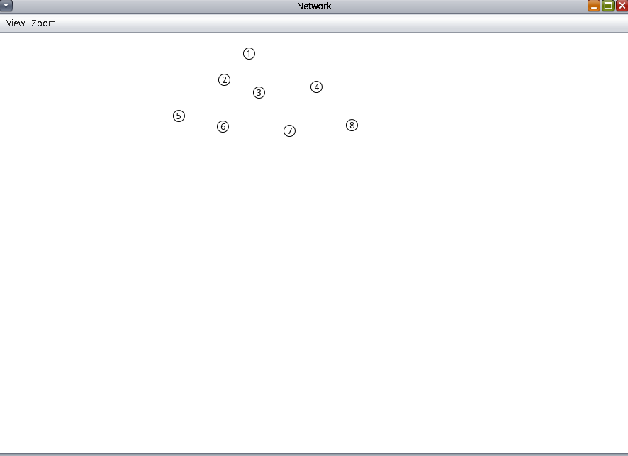
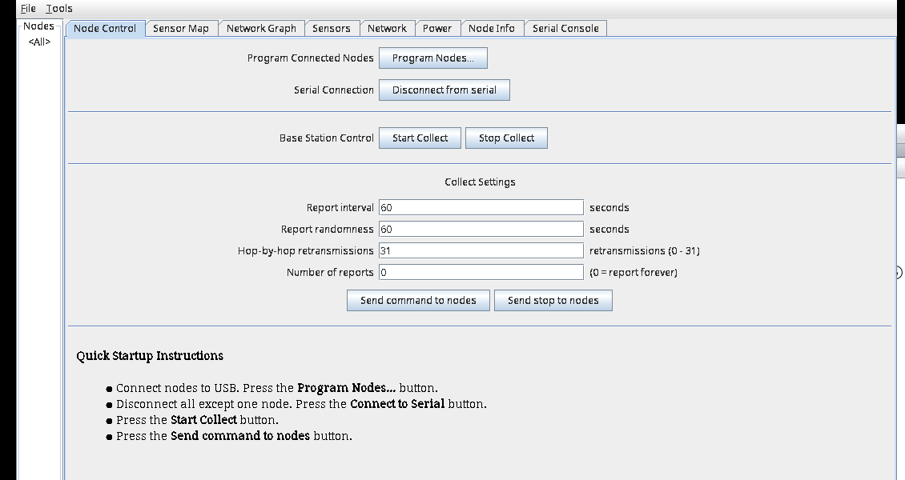
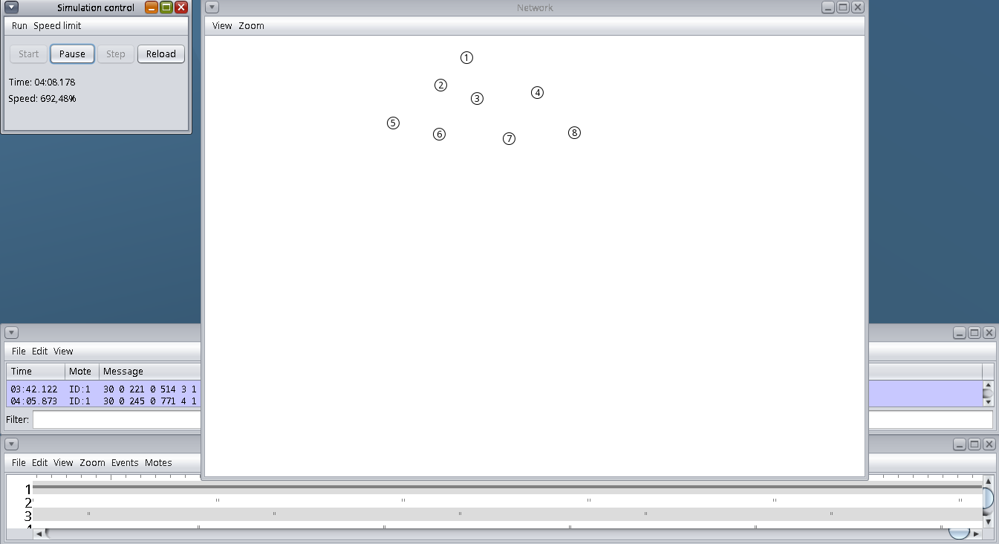
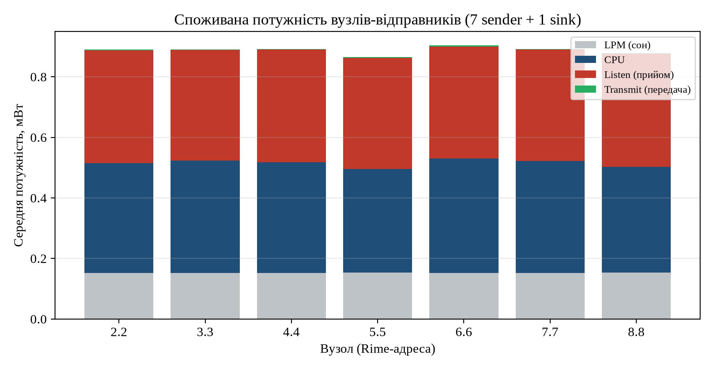

# Мета роботи

Ознайомитися з можливостями симулятора Cooja для операційної системи
Contiki. Навчитися використовувати його для моделювання поведінки базових
пристроїв промислового інтернету речей, зокрема безпровідної сенсорної
мережі з маршрутизацією RPL, та оцінювати споживану вузлами енергію.

# Постановка задачі

Відповідно до варіанта 3 необхідно змоделювати мережу збору даних із
**7 вузлів-відправників (UDP-sender) та 1 вузла-приймача (UDP-sink)** на
емульованих мотах Tmote Sky, запустити її в Cooja, зібрати дані про
поведінку мережі та дослідити споживання електроенергії вузлами
(стовпець Power у даних Collect View).

# Теоретичні відомості

Contiki є операційною системою для мережних систем з обмеженою пам'яттю
(близько 10 КБ RAM, 30 КБ ROM), орієнтованою на пристрої інтернету речей з
безпровідним зв'язком. Вона має подіє-орієнтоване ядро, вбудований стек
TCP/IP (uIP) з підтримкою IPv6 і поширюється під ліцензією BSD.

До складу Contiki входить симулятор **Cooja**, що імітує поведінку вузлів
(motes). Вузли можуть бути трьох типів: емульовані (виконується реальна
прошивка мікроконтролера через MSPSim), скомпільований код Contiki на хості,
та вузли на Java. У цій роботі використано **емульовані Sky-моти**: Cooja
через MSPSim виконує справжню прошивку MSP430, скомпільовану з коду Contiki.

Мережа побудована на прикладі `rpl-collect`: вузли використовують протокол
маршрутизації **RPL**, який будує орієнтований ациклічний граф (DODAG) із
коренем у приймачі. Відправники періодично (кожні 60 с) надсилають до
приймача пакет телеметрії, що містить, зокрема, лічильники часу роботи
підсистем (energest): час роботи процесора, час у режимі сну, час передачі
та прослуховування радіо. За цими лічильниками обчислюється споживана
потужність.

# Хід виконання

Роботу виконано не у віртуальній машині Instant Contiki, а у відтвореному
середовищі: Contiki 2.7 зібрано компілятором `msp430-gcc` 4.7.4, Cooja
зібрано (Java 8, Ant), прошивки `udp-sink.sky` і `udp-sender.sky`
скомпільовано для платформи Sky. Це та сама версія Contiki, що і в Instant
Contiki, тому шляхи та інтерфейс збігаються з методичкою.

## Створення симуляції (п. 4-8)

Симуляцію створено на базі прикладу
`/examples/ipv6/rpl-collect/collect-tree-dense-noloss.csc`, залишено 8 вузлів:
один типу **sky1** з прошивки `udp-sink.c` (приймач) і сім типу **sky2** з
прошивки `udp-sender.c` (відправники). Під час створення типу мота Cooja
компілює прошивку; повідомлення виду `LD udp-sink.sky` означає успішне
створення файлу прошивки. Радіосередовище: модель UDGM, дальність передачі
100 м, інтерференції 120 м. Відправники розміщено в межах дальності дії
приймача (відстані від 28 до 96 м), що є обов'язковою умовою доставки даних.

## Візуалізація мережі (п. 9)

У вікні Network увімкнено відображення Mote IDs, Radio environment (UDGM),
Mote attributes. Вузол 1 є приймачем, вузли 2...8 відправниками (рис. 4.1).

{ width=82% }

## Збір даних про поведінку мережі (п. 10)

Запущено симуляцію (Simulation control -> Start). Для збору даних
використано інструмент Collect View (керування у вкладці Node Control, дані у вкладці Node Info), який приймає
телеметрію через послідовний інтерфейс приймача; інтерфейс інструмента
показано на рис. 4.2. Після команди Start Collect і Send command to nodes
відправники починають надсилати звіти до приймача.

{ width=90% }

Під час роботи симуляції приймач (ID:1) друкує отримані пакети телеметрії
у вікні Log listener, а вікно Timeline показує радіоактивність вузлів
(рис. 4.3). Видно, що завдяки механізму ContikiMAC радіо вузлів переважно
вимкнене й вмикається короткими інтервалами, що характерно для
малопотужних мереж.

{ width=100% }

## Дані про споживання енергії (п. 11)

Кожен звіт містить кумулятивні лічильники energest: час роботи CPU, час у
режимі зниженого споживання (LPM), час передачі (Transmit) і прослуховування
(Listen). Споживана потужність обчислюється за формулами Collect View
(клас `SensorData`):

$$ P_x = \frac{t_x \cdot P_x^{0}}{t_\text{CPU} + t_\text{LPM}}, \qquad
   P = P_\text{CPU} + P_\text{LPM} + P_\text{Listen} + P_\text{Transmit}, $$

де $t_x$ є лічильником у тиках, а питомі потужності Sky-мота (при напрузі 3 В)
дорівнюють: $P_\text{CPU}^{0} = 5{,}4$ мВт, $P_\text{LPM}^{0} = 0{,}1635$ мВт,
$P_\text{Transmit}^{0} = 53{,}1$ мВт, $P_\text{Listen}^{0} = 60$ мВт
(1 с $= 4096$ тиків).

Журнал симуляції (`data/lab3-run.log`) оброблено скриптом `solution.py`;
результати для останнього звіту кожного вузла наведено в табл. 4.1 і на
рис. 4.4. Значення стовпця Power обчислено з перехопленого приймачем
послідовного журналу за наведеними формулами, а не зчитано зі стовпця Power
вкладки Node Info самого Collect View (у середовищі без GUI керувати цією
вкладкою неможливо); числа тотожні тим, що показав би Collect View, бо формули
й константи взято з його коду.

\needspace{6cm}

: Таблиця 4.1. Споживана потужність вузлів-відправників, мВт

| Вузол | CPU | LPM | Listen | Transmit | Усього |
|:---:|:---:|:---:|:---:|:---:|:---:|
| 2.2 | 0,362 | 0,153 | 0,373 | 0,002 | 0,890 |
| 3.3 | 0,371 | 0,152 | 0,366 | 0,002 | 0,890 |
| 4.4 | 0,365 | 0,152 | 0,374 | 0,001 | 0,892 |
| 5.5 | 0,343 | 0,153 | 0,368 | 0,002 | 0,866 |
| 6.6 | 0,378 | 0,152 | 0,370 | 0,004 | 0,905 |
| 7.7 | 0,370 | 0,152 | 0,369 | 0,001 | 0,892 |
| 8.8 | 0,350 | 0,153 | 0,373 | 0,002 | 0,878 |

{ width=92% }

# Аналіз результатів

Усі 7 відправників успішно долучилися до DODAG і надіслали по 10 звітів
до приймача, що підтверджує коректність топології та збіжність RPL.

Споживана потужність вузлів близька (0,87...0,91 мВт), бо всі відправники
виконують однакову роботу і розташовані в один хоп від приймача. Основний
внесок дають **CPU (близько 0,36 мВт)** та **прослуховування радіо
(Listen, близько 0,37 мВт)**; передача (Transmit) майже не впливає
(близько 0,004 мВт), оскільки обсяг даних малий, а завдяки ContikiMAC радіо
більшість часу вимкнене. Саме прослуховування, а не передача, є головним
споживачем енергії радіо в малопотужних мережах, тому стратегії зниження
енергоспоживання спрямовані на зменшення часу прослуховування (duty cycling).

Для об'єкта критичної інфраструктури ці дані важливі з двох причин. По-перше,
енергоспоживання визначає час автономної роботи сенсорів (наприклад, від
батарей чи збору енергії), тобто надійність моніторингу. По-друге, аномальне
зростання споживання (особливо Listen і CPU) є ознакою атаки на мережу:
штучне збільшення трафіку змушує вузли довше тримати радіо увімкненим і
обробляти зайві пакети, що виснажує батареї й може вивести вузли з ладу
(це досліджується в лабораторній роботі № 4).

# Відповіді на контрольні питання

**1. Призначення та основні переваги Contiki OS.** Contiki є ОС з відкритим
кодом для пристроїв інтернету речей з обмеженими ресурсами. Переваги:
малі вимоги до пам'яті (близько 10 КБ RAM, 30 КБ ROM), подіє-орієнтоване
ядро з підтримкою протопотоків, вбудований стек uIP з IPv4/IPv6 і 6LoWPAN,
механізми енергоощадності (ContikiMAC), вбудований симулятор Cooja, ліцензія
BSD. Застосовується в системах розумного міста: вуличне освітлення,
радіаційний моніторинг, сигналізація.

**2. Які види пристроїв є серед прикладів у `/home/user/contiki/examples/`.**
Приклади охоплюють: вузли збору даних RPL (`rpl-collect`: udp-sink, udp-sender),
прикладні вузли IPv6 (`ipv6/rpl-udp`, `rpl-border-router`, `simple-udp-rpl`),
пристрої на базі Rime (`rime`: broadcast, unicast, collect, mesh), приклади
Powertrace й energest, веб-сервер і веб-клієнт, CoAP (`er-rest-example`),
приклади для конкретних платформ (sky, z1, cc2538dk) тощо.

**3. Як здійснюється моделювання мережі у Cooja? Як задається поведінка
пристрою?** Користувач створює симуляцію, обирає радіосередовище (UDGM),
додає типи мотів і вузли. Для кожного типу мота вказується вихідний файл
Contiki (мова C), який Cooja компілює у прошивку; поведінка вузла
визначається саме цим кодом прошивки, що виконується емулятором MSPSim.
Фізичне розташування задається координатами, зв'язність обчислюється моделлю
радіосередовища за дальністю. Симуляцію можна покроково виконувати,
спостерігати радіообмін, журнали та збирати телеметрію.

**4. Чому важливо задавати фізичне розташування змодельованих пристроїв, а
не лише внутрішні налаштування?** Бо зв'язність безпровідної мережі залежить
від відстаней: вузол поза дальністю дії приймача не зможе доставити дані
(безпосередньо чи через ретрансляцію). Розташування визначає топологію
DODAG, кількість хопів, рівень інтерференції, втрати пакетів і, як наслідок,
енергоспоживання та затримки. Без коректного розташування модель не
відображатиме реальну поведінку мережі.

**5. Які задачі безпеки можна вирішувати з використанням Cooja.**
Моделювання атак на безпровідні сенсорні мережі (DIS-флуд, атаки на ранг (rank) та номер версії DODAG, sinkhole, селективне відкидання пакетів,
селективне відкидання пакетів, sinkhole, флуд) і оцінка їх впливу на трафік
та енергоспоживання; перевірка механізмів виявлення вторгнень; тестування
нових протоколів і налаштувань безпеки перед впровадженням на реальному
об'єкті; дослідження стійкості мережі до відмов і виснаження енергії;
навчання та відтворення сценаріїв інцидентів.

# Висновки

У Cooja змодельовано й запущено безпровідну сенсорну мережу (7 відправників і
1 приймач, RPL) та за лічильниками energest обчислено споживану потужність
вузлів. Ключове спостереження: основний споживач енергії, це робота процесора
й прослуховування радіо, а не передача. Отримано навички створення, запуску та
аналізу мережі у Cooja, потрібні для моделювання атак у наступній роботі.

# Перелік джерел

1. Contiki-OS. Contiki: The Open Source OS for the Internet of Things.
   URL: http://www.contiki-os.org/
2. Dunkels A., Gronvall B., Voigt T. Contiki: a lightweight and flexible
   operating system for tiny networked sensors. LCN 2004.
3. Osterlind F., Dunkels A., Eriksson J. et al. Cross-level sensor network
   simulation with COOJA. LCN 2006. P. 641...648.
4. Winter T. et al. RPL: IPv6 Routing Protocol for Low-Power and Lossy
   Networks : RFC 6550. IETF, 2012.
5. Dunkels A., Osterlind F., Tsiftes N., He Z. Software-based on-line energy
   estimation for sensor nodes (Energest). EmNets 2007.
6. Стьопочкіна І. В., Ільїн К. І., Овчарук М. В. Кіберзахист об'єктів
   критичної інфраструктури. Лабораторний практикум : навч. посіб. Київ :
   КПІ ім. Ігоря Сікорського, 2023. 59 с.

\newpage

# Додаток А. Обробка журналу (`solution.py`) {-}

\lstinputlisting[language=Python]{Labs/03-cooja/solution.py}

\newpage

# Додаток Б. Підготовка симуляції (`sim/trim_motes.py`) {-}

\lstinputlisting[language=Python]{Labs/03-cooja/sim/trim_motes.py}
