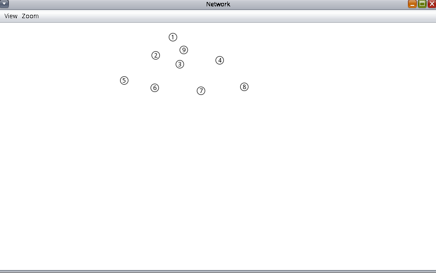
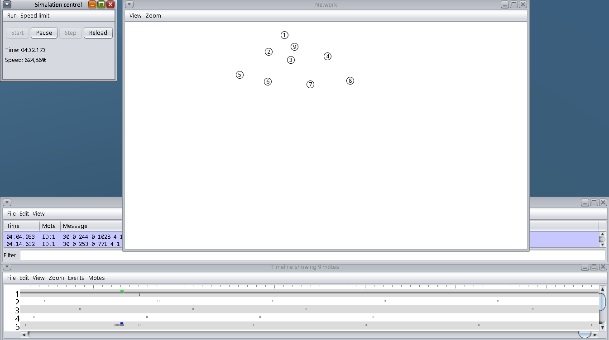
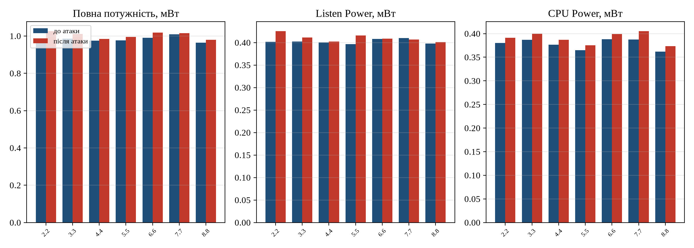

# Мета роботи

Ознайомитися з можливостями симулятора Cooja для моделювання атаки на
емульовану мережу безпровідних пристроїв об'єкта критичної інфраструктури,
зокрема DIS-атаки на протокол маршрутизації RPL, та оцінити її вплив на
споживання енергії вузлами.

# Постановка задачі

Відповідно до варіанта 3 необхідно змоделювати мережу з 7 вузлів-відправників
і 1 приймача (як у роботі № 3), додати **шкідливий вузол**, що реалізує
DIS-атаку, і порівняти споживання енергії вузлів (Power, Listen Power, CPU
Power) до та після атаки.

# Теоретичні відомості

У мережах об'єктів критичної інфраструктури використовується протокол
маршрутизації **RPL** для малопотужних мереж з втратами. RPL будує топологію
у вигляді орієнтованого ациклічного графа (DODAG) з коренем у приймачі.
Кожному вузлу присвоюється ранг (Rank), що зростає з віддаленням від кореня;
вузли обирають маршрут з найменшим рангом.

Серед керуючих повідомлень RPL є **DIS** (DODAG Information Solicitation,
ICMPv6) - запит інформації від сусіднього DODAG, аналог запиту маршрутизатора.
У нормальному режимі вузол надсилає DIS лише доки не долучиться до DODAG, з
інтервалом `RPL_DIS_INTERVAL` (60 с) і початковою затримкою
`RPL_DIS_START_DELAY` (5 с).

**DIS-атака** - це пряма атака на мережеві ресурси. Вузол під контролем
зловмисника безперервно (широкомовно) розсилає службові повідомлення DIS.
Кожне DIS змушує сусідів скинути таймери Trickle і відповісти повідомленням
DIO, що збільшує обсяг керуючого трафіку, навантаження на процесор і час
роботи радіо, а отже - споживання енергії. Тому DIS-атаку відносять до класу
DoS-атак (відмова в обслуговуванні через виснаження ресурсів та енергії).

# Хід виконання

Середовище те саме, що в роботі № 3 (Contiki 2.7, msp430-gcc, Cooja).

## Моделювання шкідливого вузла (п. 9-11)

Для імітації діяльності шкідливого вузла, що постійно надсилає DIS, змінено
два файли ядра ContikiRPL (попередньо збережено копію каталогу
`core/net/rpl`).

**Файл `rpl-private.h`** (рис. 6.1 методички) визначає приватні декларації
ContikiRPL. Інтервал DIS-повідомлень і таймер затримки запуску встановлено
в нуль:

```diff
 /* DIS related */
 #define RPL_DIS_SEND                    1
 #ifdef  RPL_DIS_INTERVAL_CONF
 #define RPL_DIS_INTERVAL                RPL_DIS_INTERVAL_CONF
 #else
-#define RPL_DIS_INTERVAL                60
+#define RPL_DIS_INTERVAL                0
 #endif
-#define RPL_DIS_START_DELAY             5
+#define RPL_DIS_START_DELAY             0
```

**Файл `rpl-timers.c`** (рис. 6.2 методички) керує таймерами. У функції
`handle_periodic_timer` прибрано умову, що зупиняла надсилання DIS після
долучення до DODAG, тому вузол розсилає DIS безперервно (щосекунди, бо
періодичний таймер спрацьовує кожну секунду, а `next_dis >= 0` завжди
істинне):

```diff
   /* handle DIS */
 #ifdef RPL_DIS_SEND
   next_dis++;
-  if(rpl_get_any_dag() == NULL && next_dis >= RPL_DIS_INTERVAL) {
+  if(next_dis >= RPL_DIS_INTERVAL) {
     next_dis = 0;
     dis_output(NULL);
   }
 #endif
```

Реалізовано **модель одного зловмисника** (як і в методичці, де шкідливим є
окремий вузол `udp-sender2`): з модифікованим RPL скомпільовано лише прошивку
`udp-sender2.sky`, а решта вузлів (приймач і 7 легітимних відправників)
використовують нормальний RPL (файли ядра відновлено з копії перед їх
компіляцією).

## Сценарії моделювання

Виконано два запуски з однаковою топологією і тривалістю (660 с модельного
часу), дані збиралися приймачем так само, як у роботі № 3:

* **до атаки** - 7 легітимних відправників (вузли 2...8) + 1 приймач (вузол 1);
* **після атаки** - ті самі вузли + шкідливий вузол 9 (прошивка
  `udp-sender2.sky`), розміщений у центрі мережі поряд з приймачем і
  вузлами 2, 3 (рис. 6.1). Вузол 9 постійно розсилає DIS.

{ width=82% }

Під час атаки симуляція показує інтенсивний радіообмін; вікно Timeline
відображає роботу 9 вузлів, приймач продовжує отримувати телеметрію (рис. 6.2).

{ width=100% }

## Обробка даних

Журнали обох запусків (`data/lab3-baseline.log`, `data/lab4-attack.log`)
оброблено скриптом `solution.py`, який за лічильниками energest обчислює
середню потужність кожного легітимного вузла (формули Collect View, як у
роботі № 3) і порівнює стани до та після атаки.

# Результати

## Вплив на легітимні вузли

Порівняння споживаної потужності вузлів 2...8 до та після атаки наведено в
табл. 6.1 і на рис. 6.3.

\needspace{6cm}

: Таблиця 6.1. Споживана потужність легітимних вузлів до/після атаки, мВт

| Вузол | Power до | Power після | Δ, % | Listen до | Listen після | CPU до | CPU після |
|:---:|:---:|:---:|:---:|:---:|:---:|:---:|:---:|
| 2.2 | 0,984 | 1,026 | +4,2 | 0,402 | 0,425 | 0,380 | 0,391 |
| 3.3 | 0,986 | 1,011 | +2,5 | 0,402 | 0,411 | 0,387 | 0,400 |
| 4.4 | 0,975 | 0,984 | +0,9 | 0,401 | 0,402 | 0,376 | 0,387 |
| 5.5 | 0,976 | 0,995 | +2,0 | 0,396 | 0,416 | 0,365 | 0,375 |
| 6.6 | 0,991 | 1,018 | +2,7 | 0,408 | 0,409 | 0,388 | 0,399 |
| 7.7 | 1,008 | 1,015 | +0,7 | 0,410 | 0,407 | 0,388 | 0,405 |
| 8.8 | 0,965 | 0,980 | +1,5 | 0,398 | 0,401 | 0,362 | 0,373 |
| **Середнє** | **0,984** | **1,004** | **+2,1** | **0,402** | **0,410** | **0,378** | **0,390** |

{ width=100% }

# Аналіз результатів

**Вплив на мережу.** Атака збільшує споживання енергії всіх семи легітимних
вузлів без винятку (рис. 6.3): у середньому повна потужність зростає на 2,1 %,
CPU на 3,2 %, Listen на 1,9 %. Найбільше зростання у вузла 2 (+4,2 %),
найближчого до зловмисника; решта вузлів показують невелике зростання в межах
0,7...2,7 % без чіткої залежності від відстані. Зростання саме Listen і CPU
(а не Transmit) підтверджує механізм атаки: вузли змушені приймати й обробляти
зайві DIS-повідомлення та відповідати на них повідомленнями DIO, тримаючи
радіо увімкненим довше.

**Передача шкідливого вузла.** Потужність передачі вузла 9 (0,056 мВт) не
виділяється на тлі легітимних вузлів (0,043...0,062 мВт). Це наслідок того, що
ContikiMAC дуплексує й обмежує навіть флуд: реальні радіопередачі DIS
розтягуються в часі, а не йдуть суцільним потоком. Тому за самою лише
потужністю передачі відрізнити зловмисника не вдається.

**Чому ефект помірний.** Один зловмисник, що розсилає DIS приблизно щосекунди
кільком сусідам, додає відносно небагато трафіку, тому зростання
енергоспоживання становить одиниці відсотків. Роль дуплексування радіо
ContikiMAC перевірено окремим сценарієм (п. нижче): вимкнення duty cycling
не підсилює атаку, а лише піднімає базову потужність. Для автономних
батарейних сенсорів навіть постійне зростання на 2...4 % скорочує час роботи,
а тривала атака лишається загрозою.

**Наслідки для ОКІ.** Навіть помірне, але постійне зростання споживання
скорочує час автономної роботи батарейних сенсорів (датчиків тиску, рівня,
температури). Оцінка для типової батареї з двох елементів AA (2500 мА·год,
послідовно 3 В, тобто 7,5 Вт·год) дає для середнього вузла 318 діб роботи до
атаки проти 311 діб під постійною атакою: лише ця помірна атака скорочує
термін служби приблизно на 6 діб (2 %), а сильніший флуд або кілька
зловмисників зменшують цей час пропорційно доданому трафіку. Виснаження й вихід таких вузлів з ладу означає втрату
спостережуваності технологічного процесу, тому для критичної інфраструктури
DIS-флуд лишається загрозою, а виявити його за самою потужністю важко.

## Додатковий сценарій: радіо завжди увімкнене

Щоб перевірити роль ContikiMAC, обидва запуски повторено з вимкненим
дуплексуванням радіо (команда `mac 0`, яку надсилає й сам Collect View при
Start Collect; радіо весь час увімкнене). Результати (табл. 6.2) неочікувані,
але показові.

\needspace{4cm}

: Таблиця 6.2. Середня потужність легітимних вузлів, радіо завжди увімкнене, мВт

| Показник | До атаки | Після атаки | Δ |
|---|:---:|:---:|:---:|
| Повна потужність | 56,10 | 56,07 | −0,0 % |
| Listen Power | 55,50 | 55,46 | −0,1 % |
| CPU Power | 0,390 | 0,400 | +2,8 % |

Без дуплексування повна потужність зростає з ~0,9 до ~56 мВт (у 60 разів),
бо радіо постійно слухає, і цей постійний Listen повністю домінує над усім
іншим. Через це DIS-атака майже **не змінює** повну потужність (−0,0 %):
вузли й так не сплять, тож флуд не може змусити їх «не спати більше».
Залишається тільки зростання CPU (+2,8 %) від обробки зайвих DIS, таке саме,
як у сценарії з ContikiMAC.

Висновок уточнює очікування методички: вимкнення duty cycling не підсилює
DIS-атаку, а лише піднімає базову «вартість» мережі; відносний вплив атаки на
енергію лишається помірним в обох режимах. Єдина стабільна енергетична ознака
DIS-флуду, це невелике (близько 3 %) зростання CPU Power, а не різкий стрибок
повної потужності.

# Відповіді на контрольні питання

**1. Призначення файлів `rpl-private.h` та `rpl-timers.c`.** `rpl-private.h`
містить приватні декларації ContikiRPL: значення за замовчуванням для
керуючих повідомлень ICMPv6 (зокрема параметри DIS: `RPL_DIS_INTERVAL`,
`RPL_DIS_START_DELAY`), пов'язані таймери, режими роботи, константи таблиць
маршрутизації DAG. `rpl-timers.c` реалізує керування таймерами ContikiRPL:
періодичний таймер (`handle_periodic_timer`), таймери Trickle для DIO,
надсилання DIS та DAO. Саме тут приймається рішення про надсилання DIS.

**2. Сутність DIS-атаки для безпровідної мережі.** Зловмисний вузол
безперервно розсилає широкомовні DIS-повідомлення (запити інформації про
DODAG). Кожне DIS змушує вузли-сусіди скидати таймери Trickle і відповідати
DIO, що різко збільшує керуючий трафік, навантаження на процесор і час роботи
радіо. Це виснажує енергію (особливо критично для батарейних пристроїв),
створює затримки й може призвести до відмови в обслуговуванні вузлів мережі.

**3. Які зміни треба внести до `rpl-private.h` та `rpl-timers.c` для
моделювання DIS-атаки?** У `rpl-private.h` встановити `RPL_DIS_INTERVAL` і
`RPL_DIS_START_DELAY` у 0 (DIS надсилатиметься без початкової затримки, а далі
щосекунди, на кожному спрацюванні періодичного таймера). У `rpl-timers.c` у функції `handle_periodic_timer` прибрати
умову `rpl_get_any_dag() == NULL`, щоб вузол надсилав DIS постійно, а не лише
доки не долучиться до DODAG. Скомпілювати з цими змінами прошивку шкідливого
вузла.

**4. Як можна розпізнати здійснення DIS-атаки в мережі ОКІ?** За аномально
високою частотою DIS-повідомлень від одного вузла (аналіз трафіку, IDS для
RPL); за різким зростанням керуючого трафіку (DIS/DIO) у сегменті; за
аномальним зростанням енергоспоживання та часу роботи радіо (Listen/CPU
Power) сусідніх вузлів; за частими скиданнями таймерів Trickle і повторними
приєднаннями до DODAG; за збільшенням затримок доставки даних. Засоби захисту:
обмеження частоти DIS, автентифікація керуючих повідомлень (Secure RPL),
виявлення аномалій трафіку та енергоспоживання.

# Висновки

У симуляторі Cooja реалізовано DIS-атаку на мережу RPL: змінами у файлах ядра
ContikiRPL (`rpl-private.h`, `rpl-timers.c`) скомпільовано шкідливий вузол, що
безперервно розсилає DIS, тоді як решта мережі працює на нормальному RPL.
Атака підвищила споживання енергії всіх легітимних вузлів (у середньому на
2,1 %, CPU на 3,2 %), найбільше у найближчого до зловмисника (+4,2 %); зростання
Listen і CPU підтверджує механізм виснаження ресурсів через обробку зайвих
DIS. У термінах автономності це скорочує час роботи вузла від двох батарей AA
з 318 до 311 діб (−6 діб, або −2 % від терміну служби). Головний висновок стосується захисту: механізм ContikiMAC дає мережі
відчутну стійкість до DIS-флуду за енергоспоживанням (ефект обмежений одиницями
відсотків, а передача зловмисника не виділяється на тлі інших), тому за самою
потужністю виявити атаку важко; потрібні інші ознаки, перелічені у відповіді
на питання 4. Додатковий запуск з вимкненим дуплексуванням радіо показав, що це
не підсилює атаку, а лише піднімає базову потужність у ~60 разів; відносний
вплив DIS-флуду лишається помірним в обох режимах, а його стабільною ознакою є
невелике (близько 3 %) зростання CPU Power.

# Перелік джерел

1. Winter T. et al. RPL: IPv6 Routing Protocol for Low-Power and Lossy
   Networks : RFC 6550. IETF, 2012.
2. Mayzaud A., Badonnel R., Chrisment I. A Taxonomy of Attacks in RPL-based
   Internet of Things. Int. J. of Network Security, 2016.
3. Osterlind F., Dunkels A., Eriksson J. et al. Cross-level sensor network
   simulation with COOJA. LCN 2006.
4. Dunkels A. et al. Software-based on-line energy estimation for sensor
   nodes (Energest). EmNets 2007.
5. Стьопочкіна І. В., Ільїн К. І., Овчарук М. В. Кіберзахист об'єктів
   критичної інфраструктури. Лабораторний практикум : навч. посіб. Київ :
   КПІ ім. Ігоря Сікорського, 2023. 59 с.

\newpage

# Додаток А. Порівняння енергоспоживання (`solution.py`) {-}

\lstinputlisting[language=Python]{Labs/04-cooja-attack/solution.py}
