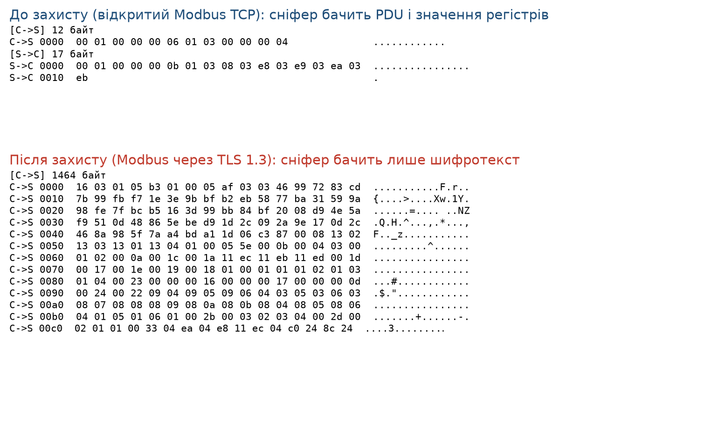

# Мета роботи

Ознайомитися з недоліками протоколів пристроїв інтернету речей, що є частиною
об'єктів критичної інфраструктури, і типовими програмними рішеннями з їх
усунення. На прикладі протоколу Modbus впровадити криптографічний захист
засобами бібліотеки OpenSSL і показати його дієвість за допомогою сніфера.

# Постановка задачі

Згідно з варіантом (парний, Modbus v3.1.6):

1. проаналізувати вразливості протоколу Modbus;
2. запропонувати й обґрунтувати криптографічні засоби захисту;
3. реалізувати захищену взаємодію «клієнт-сервер» засобами OpenSSL;
4. показати дієвість захисту за допомогою сніфера, що перехоплює пакети, -
   порівняти трафік до та після впровадження захисту.

# Теоретичні відомості

## Протокол Modbus і його вразливості

Modbus, протокол прикладного рівня для промислової автоматизації (релейний
захист, програмно-логічні контролери). Працює за моделлю «ведучий-ведений»
(master-slave) з транзакціями «запит-відповідь». Основою є пакет PDU (Protocol
Data Unit): однобайтовий код функції (1...127) і поле даних. Для передачі PDU
загортається в ADU; у версії Modbus TCP перед PDU додається заголовок MBAP
(ID транзакції, ID протоколу, довжина, адреса пристрою), а поле контрольної
суми відсутнє (цілісність покладено на TCP).

Головні вразливості базового Modbus:

* **відсутність автентифікації**, сервер виконує будь-який коректно
  сформований запит, не перевіряючи, від кого він;
* **відсутність шифрування**, дані (коди функцій, адреси й значення
  регістрів) передаються у відкритому вигляді;
* **відсутність контролю цілісності** на рівні протоколу, немає підпису чи
  імітовставки, тому дані можна непомітно підмінити (атака «людина
  посередині», MITM).

Наслідок для об'єкта критичної інфраструктури: зловмисник, що має доступ до
каналу зв'язку, може зчитувати технологічні параметри (розвідка) та підміняти
команди й уставки контролерів, що безпосередньо загрожує технологічному
процесу.

## Засоби усунення й обґрунтування вибору

Оскільки сам Modbus не має механізмів безпеки, захист реалізують на
транспортному рівні, загортаючи з'єднання в **TLS** (цей підхід стандартизовано
як *Modbus/TCP Security* специфікацією Modbus Organization). TLS одразу
закриває всі три вразливості:

* **конфіденційність**, симетричне шифрування корисного навантаження;
* **цілісність і автентичність повідомлень**, режим AEAD (вбудована
  імітовставка) виявляє будь-яку підміну;
* **автентифікація сторін**, за допомогою цифрових сертифікатів X.509,
  перевірених довіреним центром сертифікації (CA).

Вибір криптографічних примітивів (їх узгоджує TLS 1.3):

* **TLS 1.3** як мінімальна версія, прибрано застарілі й небезпечні набори
  шифрів, обов'язковий режим AEAD, швидше рукостискання (1-RTT);
* **ECDHE** (обмін ключами на еліптичних кривих з ефемерними ключами) -
  забезпечує *пряму секретність* (perfect forward secrecy): компрометація
  довгострокового ключа не розкриває раніше перехоплений трафік;
* **AES-256-GCM**, автентифікований симетричний шифр (AEAD): одночасно
  шифрування й контроль цілісності;
* **ECDSA на кривій P-256** для ключів сертифікатів, короткі ключі й швидке
  підписування, що важливо для обмежених ресурсів ПЛК;
* **автентифікація сервера за сертифікатом**, підписаним власним центром сертифікації об'єкта;
  клієнт відхиляє з'єднання, якщо сертифікат не підтверджено (захист від MITM).

# Хід виконання

## Реалізація

Реалізовано мінімальний Modbus TCP клієнт і сервер мовою C
(`src/modbus_tcp.c`), що підтримують функцію 0x03 (Read Holding Registers) за
специфікацією Modbus Application Protocol v1.1b3. Прапорець `--tls` загортає
той самий прикладний обмін у TLS 1.3 засобами OpenSSL, не змінюючи логіку
Modbus; завдяки цьому порівняння «до/після» коректне. Ввід-вивід
абстраговано: функції `conn_read`/`conn_write` працюють або зі звичайним
сокетом, або через `SSL_read`/`SSL_write`.

Сертифікати створено скриптом `gen-certs.sh`: власний кореневий CA (ECDSA
P-256) і підписаний ним сертифікат сервера з ім'ям `plc.local` і SAN на
127.0.0.1. Клієнт перевіряє сертифікат сервера за `ca.crt`
(`SSL_VERIFY_PEER`) і розриває з'єднання, якщо перевірка не пройшла.

Для перехоплення трафіку використано прозорий TCP-проксі-сніфер
(`src/sniffer.py`), що моделює зловмисника на шляху «клієнт-сервер»: він
пересилає байти між сторонами й друкує їх у форматі hex. Такий сніфер бачить
рівно те, що передається каналом (апаратний сніфер типу Wireshark у середовищі
без прав на захоплення пакетів недоступний, тому застосовано проксі; результат
для вмісту пакетів ідентичний). Обидва сценарії відтворюються скриптом
`run.sh`.

## Параметри захищеного з'єднання

Перевірка з'єднання (`openssl s_client`):

```
Protocol  : TLSv1.3
Cipher    : TLS_AES_256_GCM_SHA384
subject=  C=UA, O=Water Utility OKI, CN=plc.local
issuer=   C=UA, O=Water Utility OKI, CN=OKI Modbus CA
Verify return code: 0 (ok)
```

З'єднання використовує TLS 1.3 з AES-256-GCM, сертифікат сервера підтверджено
ланцюжком до нашого CA.

# Результати сніфінгу

Клієнт в обох сценаріях читає 4 регістри від адреси 0; сервер повертає
значення 1000...1003. Перехоплений трафік наведено на рис. 5.1.

{ width=100% }

**До захисту** весь обмін читається у відкритому вигляді:

* запит `C->S`: `00 01 00 00 00 06 01 03 00 00 00 04`, MBAP (ID транзакції
  `0001`, протокол `0000`, довжина `0006`, пристрій `01`) і PDU
  (код функції `03` = читання регістрів, початкова адреса `0000`, кількість
  `0004`);
* відповідь `S->C`: `... 01 03 08 03 e8 03 e9 03 ea 03 eb`, код функції `03`,
  8 байтів даних і значення регістрів `03 e8`...`03 eb`, тобто 1000...1003.

Зловмисник бачить і команду, і технологічні значення, і може їх підмінити.

**Після захисту** у трафіку видно лише рукостискання TLS і зашифровані записи.
Автоматична перевірка перехоплених дампів підтверджує, що відкриті дані зникли
(табл. 5.1).

\needspace{5cm}

: Таблиця 5.1. Наявність відкритих даних Modbus у перехопленому трафіку

| Шукана послідовність | До захисту | Після TLS |
|---|:---:|:---:|
| PDU запиту `01 03 00 00 00 04` | присутня | відсутня |
| Значення регістрів `03 e8 03 e9` (1000, 1001) | присутня | відсутня |
| Записи TLS (типи 16/14/17) | немає | ClientHello, ServerHello, ChangeCipherSpec, 11 записів Application Data (`17 03 03`) |

Отже, після впровадження TLS сніфер не отримує жодної корисної інформації:
ні команд, ні значень регістрів, ні можливості їх непомітно підмінити.

# Активні атаки на канал зв'язку

Пасивне спостереження доводить лише втрату читабельності трафіку, тому
сніфер доповнено трьома активними атаками (режими `--flip`, `--replay` та
окремий підробний сервер). Режим `--flip` підробляє один байт у запиті
клієнта (молодший байт початкової адреси регістрів 0 -> 8, тобто команда
«читати регістри 0...3» перетворюється на «читати 8...11»); режим `--replay`
після першої відповіді повторно надсилає серверу перехоплений запит.

**Підміна команд.** У відкритому Modbus атака вдається повністю: сервер
виконує підроблену команду, і клієнт отримує значення регістрів 1008...1011
замість замовлених 1000...1003 (`data/client-plain-flip.txt`), тобто
зловмисник непомітно керує тим, що читає (а в разі
функції запису й тим, що виконує) контролер. У TLS той самий напад призводить до негайного розриву:
сервер виявляє невідповідність імітовставки AEAD і надсилає попередження
`bad record mac` (SSL alert 20), клієнт завершує роботу з помилкою
(`data/client-tls-flip.txt`).

**Повторне відтворення.** Для відкритого Modbus повторений запит є
законним запитом: сервер виконує його ще раз, і клієнт приймає дублікат
відповіді (17 неочікуваних байтів з тими самими значеннями регістрів,
`data/client-plain-replay.txt`). У TLS повторно надісланий запис
Application Data відхиляється: номери записів уже витрачені, сервер
розриває з'єднання, і клієнт не отримує нічого
(`data/client-tls-replay.txt`).

**Підробний сервер.** Клієнт, що перевіряє сертифікат, відмовляється від
з'єднання з сервером, сертифікат якого не підписано довіреним CA
(`certificate verify failed`, `data/client-evil-server.txt`); без цієї
перевірки саме так працювала би атака «людина посередині».

\needspace{4cm}

: Таблиця 5.2. Результати активних атак до та після впровадження TLS

| Атака | Відкритий Modbus | Modbus через TLS 1.3 |
|---|---|---|
| Підміна байта команди | виконується непомітно (клієнт отримує інші регістри) | відхиляється, попередження `bad record mac` |
| Повторне відтворення запиту | виконується, клієнт отримує дублікат відповіді | відхиляється, сервер розриває з'єднання |
| Підробний сервер (невірний CA) | можливий (автентифікації немає) | клієнт відмовляється від з'єднання |

# Ціна захисту

Витрати на захист виміряно на 200 послідовних з'єднаниях по 20 запитів
через проксі-сніфер на локальному вузлі (`--bench`, `data/bench.txt`).

\needspace{3cm}

: Таблиця 5.3. Середній час встановлення з'єднання та запиту

| Показник | Відкритий Modbus | Modbus через TLS 1.3 |
|---|---:|---:|
| З'єднання з рукостисканням, мс | 0,026 | 1,13 |
| Запит-відповідь, мс | 0,020 | 2,10 |

Рукостискання TLS 1.3 коштує близько 1 мс, а шифрування запису підіймає
час обміну з ~0,02 до ~2 мс, тобто на два порядки в абсолютних величинах.
Однак у реальному циклі опитування ПЛК (десятки-сотні мілісекунд) ці
витрати непомітні, а рукостискання оплачується один раз на сесію; для
обмежених контролерів частину навантаження можна перенести на прозорий
шлюз. Отже, аргумент «TLS задорогий для ОТ» у цьому сценарії не
підтверджується.

# Аналіз результатів

Порівняння показує, що TLS усуває всі три вразливості базового Modbus
(табл. 5.4), причому активні атаки (табл. 5.2) доводять це безпосередньо,
а не лише наявністю шифротексту в дампі.

\needspace{5cm}

: Таблиця 5.4. Властивості Modbus до та після захисту

| Властивість | Базовий Modbus | Modbus через TLS 1.3 |
|---|---|---|
| Конфіденційність | немає (відкритий текст) | AES-256-GCM |
| Цілісність повідомлень | немає (лише TCP) | AEAD (виявляє підміну) |
| Автентифікація сторін | немає | сертифікати X.509 + CA |
| Пряма секретність | немає | ECDHE |

Ціна захисту виміряно безпосередньо (табл. 5.3): близько 1 мс на
рукостискання і ~2 мс на запит, що непомітно в реальному циклі опитування.
Для багатьох застарілих ПЛК, що не підтримують TLS, захист реалізують
«прозорим шлюзом» (termination proxy) перед пристроєм. Варто зауважити
обмеження: TLS із автентифікацією лише сервера не захищає від зловмисника,
що видає себе за довірений клієнт, тому для команд запису специфікація
Modbus/TCP Security передбачає взаємну автентифікацію (mTLS); повна
модель загроз вимагає також сегментації мережі та контролю доступу
(IEC 62443).

# Відповіді на контрольні питання

**1. Які вразливості має протокол Modbus.** У базовому варіанті відсутні
автентифікація сторін і шифрування; дані (коди функцій, адреси й значення
регістрів) передаються у відкритому вигляді; немає контролю цілісності на
рівні протоколу (у Modbus TCP немає навіть контрольної суми). Це уможливлює
сніфінг, підміну команд і даних (MITM), несанкціоновані запити до контролерів,
а також атаки повторного відтворення (replay). Додатково: функція читання/
запису будь-яких регістрів без обмеження прав і відсутність захисту від
перевантаження запитами (DoS).

**2. Які засоби усунення вразливостей варто використовувати у більшості
протоколів інтернету речей ОКІ.** Основою є криптографічний захист каналу:
шифрування корисного навантаження (симетричні AEAD-шифри, напр. AES-GCM),
контроль цілісності (імітовставки HMAC або вбудовані в AEAD), автентифікація
сторін за цифровими сертифікатами (X.509, PKI) або попередньо розподіленими
ключами, обмін ключами з прямою секретністю (ECDHE), захист від повторного
відтворення (лічильники, мітки часу, nonce). На практиці це реалізують
стандартними протоколами, TLS/DTLS (для TCP/UDP), а для обмежених пристроїв
відповідні профілі. Доповнюють їх організаційні й мережеві заходи: сегментація
IT/OT, контроль доступу, оновлення прошивок, моніторинг трафіку (відповідно до
IEC 62443).

# Висновки

На прикладі протоколу Modbus впроваджено криптографічний захист засобами
OpenSSL: той самий обмін Modbus TCP загорнуто в TLS 1.3 (AES-256-GCM, обмін
ключами ECDHE, автентифікація сервера сертифікатом X.509, підписаним власним
CA). Дієвість перевірено і пасивно, і активно: сніфер-зловмисник, що стоїть
на шляху з'єднання, у відкритому режимі читав команди й значення регістрів
у відкритому вигляді, а з активними атаками непомітно підміняв команду
(клієнт отримав регістри 1008...1011 замість 1000...1003) і виконував повторне
відтворення запитів (клієнт приймав дублікати відповідей). Після впровадження
TLS усі три атаки провалилися: підміна виявляється імітовставкою AEAD
(`bad record mac`), повторне відтворення відхиляється номерами записів,
підробний сервер розпізнається перевіркою сертифіката, а в трафіку лишилися тільки рукостискання
й зашифровані записи. Виміряна ціна захисту (~1 мс на рукостискання, ~2 мс
на запит) непомітна в реальному циклі опитування ПЛК; для застарілих
контролерів TLS впроваджують прозорим шлюзом, а для захисту від підробних
клієнтів застосовують взаємну автентифікацію (mTLS, Modbus/TCP Security).

# Перелік джерел

1. Modbus Organization. MODBUS Application Protocol Specification V1.1b3. 2012.
   URL: https://www.modbus.org/specs.php
2. Modbus Organization. MODBUS/TCP Security Protocol Specification. 2018.
3. libmodbus, A Modbus library (v3.1.6).
   URL: https://github.com/stephane/libmodbus
4. OpenSSL Project. OpenSSL 3.x Documentation.
   URL: https://www.openssl.org/docs/
5. Rescorla E. The Transport Layer Security (TLS) Protocol Version 1.3 :
   RFC 8446. IETF, 2018.
6. IEC 62443. Industrial communication networks. Network and system security.
7. Стьопочкіна І. В., Ільїн К. І., Овчарук М. В. Кіберзахист об'єктів
   критичної інфраструктури. Лабораторний практикум : навч. посіб. Київ :
   КПІ ім. Ігоря Сікорського, 2023. 59 с.

\newpage

# Додаток А. Клієнт/сервер Modbus TCP з TLS (`src/modbus_tcp.c`) {-}

\lstinputlisting[language=C]{Labs/05-modbus-tls/src/modbus_tcp.c}

\newpage

# Додаток Б. Проксі-сніфер (`src/sniffer.py`) {-}

\lstinputlisting[language=Python]{Labs/05-modbus-tls/src/sniffer.py}

\newpage

# Додаток В. Відтворення сценаріїв (`run.sh`) {-}

\lstinputlisting[language=bash]{Labs/05-modbus-tls/run.sh}
